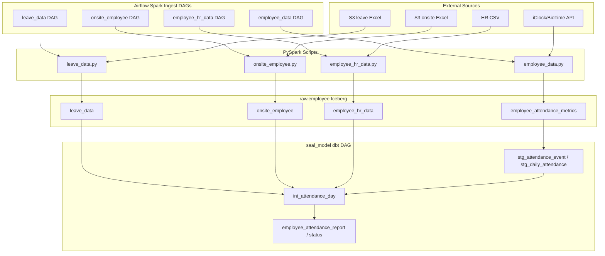

<!-- Generated by SpecStory, Markdown v2.1.0 -->

# 2026-09-01 08:26:29Z

<!-- Cursor IDE Session 8697a21d-0c99-4e7d-b0de-f023dc76171c (2026-09-01 08:26:29Z) -->

_**User**_

Explore the employee_qa codebase at /Users/s.shameem/saal_employee/employee_qa to understand the employee data pipeline, especially how attendance is fetched from APIs. Find:
1. Main pipeline entry points and scripts
2. Where attendance API calls are made
3. How date ranges/months are currently determined for attendance fetching
4. Any config files related to attendance (like onsite_employee.json)
5. Related services, utilities, or date logic

Return a detailed summary with file paths, relevant function names, and how to implement "fetch previous month's attendance when run in current month (e.g., Sep run fetches Aug)".

---

_**Agent (composer-2.5)**_

<think><details><summary>Thought Process</summary>
Beginning exploration of the employee_qa codebase to map the employee data pipeline and identify how attendance APIs are called.

Searching the codebase for pipeline entry points, attendance API calls, date range logic, and configuration files. Starting with parallel.y.
</details></think>

_**Agent (composer-2.5)**_

I'll map the employee data pipeline by locating entry points, attendance API usage, and date-range logic across the repo.


_**Agent (composer-2.5)**_

<tool-use data-tool-type="unknown" data-tool-name="update_current_step"><details>
<summary>Tool use: **update_current_step**</summary>
An unknown error occurred
</details></tool-use>

_**Agent (composer-2.5)**_

<tool-use data-tool-type="search" data-tool-name="glob_file_search"><details>
<summary>Tool use: **glob_file_search** • Searched codebase "" • **109** results in **1** directory</summary>

Directory: **`/Users/s.shameem/saal_employee/employee_qa`** (109 files)

| File |
|------|
| `.specstory/history/2026-09-01_08-25-12Z-employee-attendance-data-pipeline.md` |
| `.specstory/statistics.json` |
| `.specstory/history/2026-09-01_08-26-29Z-explore-the-employee-qa.md` |
| `.specstory/history/2026-08-31_05-29-41Z-pipeline-running-schedule.md` |
| `.specstory/.project.json` |
| `.specstory/history/2026-08-27_06-44-29Z-s3a-lakehouse-employee-paths.md` |
| `.specstory/history/2026-08-27_12-40-22Z-employee-id-data-issue.md` |
| `saal-data-model/macros/employee_identity.sql` |
| `saal-data-model/models/semantic/employee_hr_attendance_status.sql` |
| `saal-data-model/models/semantic/_semantic__models.yml` |
| `saal-data-model/models/intermediate/_intermediate__models.yml` |
| `saal-data-model/models/intermediate/int_attendance_day.sql` |
| `saal-data-model/tests/assert_employee_id_is_not_email.sql` |
| `employee_data/tests/test_onsite_employee_columns.py` |
| `employee_data/tests/test_leave_data_columns.py` |
| `employee_data/tests/test_employee_data.py` |
| `employee_data/config/onsite_employee.json` |
| `employee_data/config/leave_data.json` |
| `employee_data/dependencies/scripts/onsite_employee.py` |
| `employee_data/dependencies/scripts/leave_data.py` |
| `employee_data/config/employee_data.json` |
| `employee_data/dependencies/scripts/employee_data.py` |
| `saal-data-model/models/semantic/employee_attendance_report.sql` |
| `saal-data-model/models/staging/employee/_employee__models.yml` |
| `saal-data-model/models/staging/employee/stg_onsite_employee.sql` |
| `saal-data-model/models/semantic/employee_attendance.sql` |
| `saal-data-model/models/staging/sources.yml` |
| `saal-data-model/flows/saal_model.py` |
| `saal-data-model/models/semantic/employee_attendance_status.sql` |
| `saal-data-model/python_tests/test_dbt_runner.py` |
| `saal-data-model/macros/attendance_reporting_bounds.sql` |
| `saal-data-model/config/saal_model.json` |
| `.specstory/history/2026-08-27_08-32-56Z-employee-data-pipeline-fetch.md` |
| `.pytest_cache/v/cache/stepwise` |
| `.pytest_cache/v/cache/lastfailed` |
| `.pytest_cache/v/cache/nodeids` |
| `employee_data/flows/employee_data.py` |
| `saal-data-model/models/staging/employee/stg_daily_attendance.sql` |
| `.specstory/history/2026-08-27_06-44-29Z-s3-path-for-leave.md` |
| `employee_data/.specstory/.project.json` |
| `employee_data/.specstory/cli/config.toml` |
| `employee_data/.cursorindexingignore` |
| `.specstory/history/2026-08-26_13-39-18Z-find-extra-folder-intent.md` |
| `.specstory/history/2026-08-26_13-31-56Z-find-employee-s3-upload.md` |
| `.specstory/history/2026-08-26_12-42-30Z-s3-folder-addition.md` |
| `.specstory/history/2026-08-26_11-35-24Z-api-service-project-setup.md` |
| `.specstory/history/2026-08-26_11-50-39Z-explore-project-structure.md` |
| `.specstory/history/2026-08-26_11-50-39Z-explore-minio-and-uploads.md` |
| `employee_data/.pytest_cache/v/cache/nodeids` |
| `.specstory/history/2026-08-26_11-02-03Z-monthly-api-report-generation.md` |
| `saal-data-model/dbt_project.yml` |
| `.specstory/history/2026-08-26_11-17-51Z-report-generation-exploration.md` |
| `.specstory/history/2026-08-26_11-02-03Z-api-data-request-for.md` |
| `.specstory/history/2026-08-26_09-43-04Z-missing-punch-and-leave.md` |
| `saal-data-model/tests/assert_employee_hr_attendance_status_weekdays_only.sql` |
| `saal-data-model/tests/assert_employee_hr_attendance_status_grain.sql` |
| `employee_data/.pytest_cache/CACHEDIR.TAG` |
| `employee_data/.pytest_cache/.gitignore` |
| `employee_data/.pytest_cache/README.md` |
| `employee_data/dependencies/resources/employee_hr_master - employee_master.csv` |
| `.specstory/history/2026-08-26_06-42-41Z-employee-hr-data-reupload.md` |
| `.specstory/history/2026-08-26_06-31-51Z-attendance-status-table-design.md` |
| `saal-data-model/tests/assert_employee_attendance_status_grain.sql` |
| `saal-data-model/models/staging/employee/stg_leave_data.sql` |
| `.specstory/history/2026-08-26_06-00-49Z-saal-model-explanation.md` |
| `.specstory/history/2026-08-25_13-46-14Z-business-email-data-issues.md` |
| `saal-data-model/models/staging/employee/stg_attendance_event.sql` |
| `saal-data-model/tests/assert_employee_attendance_report_grain.sql` |
| `.specstory/history/2026-08-25_13-23-43Z-daily-attendance-data-join.md` |
| `.specstory/history/2026-08-25_11-53-01Z-employee-data-script-modification.md` |
| `.specstory/history/2026-08-25_09-49-19Z-dbt-command-failure-logs.md` |
| `.specstory/history/2026-08-25_09-38-03Z-airflow-spark-application-failure.md` |
| `.specstory/history/2026-08-25_09-29-48Z-airflow-spark-application-failure.md` |
| `.specstory/history/2026-08-25_09-12-47Z-keyerror-in-employee-data.md` |
| `saal-data-model/tests/assert_stg_daily_attendance_covered_by_int_attendance_day.sql` |
| `saal-data-model/models/staging/employee/stg_employee_hr.sql` |
| `employee_data/tests/test_employee_hr_data.py` |
| `saal-data-model/models/semantic/employee_departments.sql` |
| `employee_data/dependencies/scripts/employee_hr_data.py` |
| `.specstory/history/2026-08-25_13-46-14Z-business-email-null-values.md` |
| `employee_data/tests/.pytest_cache/v/cache/nodeids` |
| `saal-data-model/macros/trino_create_schema.sql` |
| `saal-data-model/macros/ensure_iceberg_schema.sql` |
| `saal-data-model/.env` |
| `saal-data-model/config_example.json` |
| `saal-data-model/profiles.yml` |
| `employee_data/flows/employee_hr_data_flow.py` |
| `employee_data/config/employee_hr_data.json` |
| `employee_data/flows/onsite_employee_flow.py` |
| `employee_data/tests/.pytest_cache/CACHEDIR.TAG` |
| `employee_data/tests/.pytest_cache/.gitignore` |
| `employee_data/tests/.pytest_cache/README.md` |
| `employee_data/flows/leave_data_flow.py` |
| `.airflowignore` |
| `saal-data-model/.airflowignore` |
| `.pytest_cache/CACHEDIR.TAG` |
| `.pytest_cache/.gitignore` |
| `.pytest_cache/README.md` |
| `employee_data/tests/test_metastore_uris.py` |
| `employee_data/flows/metastore_uris.py` |
| `.specstory/cli/config.toml` |
| `employee_data/.airflowignore` |
| `saal-data-model/macros/source_or_empty.sql` |
| `employee_data/.gitignore` |
| `.vscode/settings.json` |
| `.cursorindexingignore` |
| `saal-data-model/requirements.txt` |
| `saal-data-model/.gitignore` |
| `saal-data-model/macros/generate_schema_name.sql` |
</details></tool-use>

_**Agent (composer-2.5)**_

<tool-use data-tool-type="unknown" data-tool-name="ripgrep_raw_search"><details>
<summary>Tool use: **ripgrep_raw_search**</summary>

Parameters:

```json
{
  "caseInsensitive": true,
  "path": "/Users/s.shameem/saal_employee/employee_qa",
  "pattern": "attendance"
}
```
Additional data:

```json
{
  "isPruned": true,
  "outputMode": "content",
  "path": "/Users/s.shameem/saal_employee/employee_qa",
  "pattern": "attendance",
  "topFiles": [
    {
      "matchCount": 1,
      "uri": "./.specstory/history/2026-09-01_08-25-12Z-employee-attendance-data-pipeline.md"
    },
    {
      "matchCount": 5,
      "uri": "./.specstory/history/2026-09-01_08-26-29Z-explore-the-employee-qa.md"
    },
    {
      "matchCount": 2,
      "uri": "./.specstory/history/2026-08-31_05-29-41Z-pipeline-running-schedule.md"
    },
    {
      "matchCount": 289,
      "uri": "./.specstory/history/2026-08-27_06-44-29Z-s3a-lakehouse-employee-paths.md"
    },
    {
      "matchCount": 122,
      "uri": "./.specstory/history/2026-08-27_12-40-22Z-employee-id-data-issue.md"
    },
    {
      "matchCount": 21,
      "uri": "./saal-data-model/models/semantic/employee_hr_attendance_status.sql"
    },
    {
      "matchCount": 18,
      "uri": "./saal-data-model/models/semantic/_semantic__models.yml"
    },
    {
      "matchCount": 6,
      "uri": "./saal-data-model/models/intermediate/_intermediate__models.yml"
    },
    {
      "matchCount": 24,
      "uri": "./saal-data-model/models/intermediate/int_attendance_day.sql"
    },
    {
      "matchCount": 3,
      "uri": "./saal-data-model/tests/assert_employee_id_is_not_email.sql"
    },
    {
      "matchCount": 5,
      "uri": "./employee_data/tests/test_employee_data.py"
    },
    {
      "matchCount": 3,
      "uri": "./employee_data/dependencies/scripts/onsite_employee.py"
    },
    {
      "matchCount": 1,
      "uri": "./employee_data/dependencies/scripts/leave_data.py"
    },
    {
      "matchCount": 2,
      "uri": "./employee_data/config/employee_data.json"
    },
    {
      "matchCount": 6,
      "uri": "./employee_data/dependencies/scripts/employee_data.py"
    },
    {
      "matchCount": 9,
      "uri": "./saal-data-model/models/semantic/employee_attendance_report.sql"
    },
    {
      "matchCount": 15,
      "uri": "./saal-data-model/models/staging/employee/_employee__models.yml"
    },
    {
      "matchCount": 13,
      "uri": "./saal-data-model/models/staging/employee/stg_onsite_employee.sql"
    },
    {
      "matchCount": 4,
      "uri": "./saal-data-model/models/semantic/employee_attendance.sql"
    },
    {
      "matchCount": 10,
      "uri": "./saal-data-model/models/staging/sources.yml"
    }
  ],
  "totalFiles": 51,
  "totalMatches": 1822
}
```
Status: **completed**

</details></tool-use>

_**Agent (composer-2.5)**_

<tool-use data-tool-type="unknown" data-tool-name="ripgrep_raw_search"><details>
<summary>Tool use: **ripgrep_raw_search**</summary>

Parameters:

```json
{
  "caseInsensitive": false,
  "path": "/Users/s.shameem/saal_employee/employee_qa",
  "pattern": "onsite_employee"
}
```
Additional data:

```json
{
  "isPruned": true,
  "outputMode": "content",
  "path": "/Users/s.shameem/saal_employee/employee_qa",
  "pattern": "onsite_employee",
  "topFiles": [
    {
      "matchCount": 1,
      "uri": "./.specstory/history/2026-09-01_08-26-29Z-explore-the-employee-qa.md"
    },
    {
      "matchCount": 15,
      "uri": "./.specstory/history/2026-08-31_05-29-41Z-pipeline-running-schedule.md"
    },
    {
      "matchCount": 114,
      "uri": "./.specstory/history/2026-08-27_06-44-29Z-s3a-lakehouse-employee-paths.md"
    },
    {
      "matchCount": 30,
      "uri": "./.specstory/history/2026-08-27_12-40-22Z-employee-id-data-issue.md"
    },
    {
      "matchCount": 1,
      "uri": "./saal-data-model/models/intermediate/int_attendance_day.sql"
    },
    {
      "matchCount": 14,
      "uri": "./employee_data/tests/test_onsite_employee_columns.py"
    },
    {
      "matchCount": 5,
      "uri": "./employee_data/config/onsite_employee.json"
    },
    {
      "matchCount": 6,
      "uri": "./employee_data/dependencies/scripts/onsite_employee.py"
    },
    {
      "matchCount": 2,
      "uri": "./employee_data/dependencies/scripts/employee_data.py"
    },
    {
      "matchCount": 1,
      "uri": "./saal-data-model/models/staging/employee/_employee__models.yml"
    },
    {
      "matchCount": 1,
      "uri": "./saal-data-model/models/staging/employee/stg_onsite_employee.sql"
    },
    {
      "matchCount": 1,
      "uri": "./saal-data-model/models/staging/sources.yml"
    },
    {
      "matchCount": 13,
      "uri": "./.specstory/history/2026-08-27_08-32-56Z-employee-data-pipeline-fetch.md"
    },
    {
      "matchCount": 10,
      "uri": "./.pytest_cache/v/cache/nodeids"
    },
    {
      "matchCount": 20,
      "uri": "./.specstory/history/2026-08-26_11-35-24Z-api-service-project-setup.md"
    },
    {
      "matchCount": 12,
      "uri": "./employee_data/.pytest_cache/v/cache/nodeids"
    },
    {
      "matchCount": 41,
      "uri": "./.specstory/history/2026-08-26_11-02-03Z-monthly-api-report-generation.md"
    },
    {
      "matchCount": 1,
      "uri": "./.specstory/history/2026-08-26_09-43-04Z-missing-punch-and-leave.md"
    },
    {
      "matchCount": 3,
      "uri": "./.specstory/history/2026-08-26_06-31-51Z-attendance-status-table-design.md"
    },
    {
      "matchCount": 10,
      "uri": "./.specstory/history/2026-08-25_13-46-14Z-business-email-data-issues.md"
    }
  ],
  "totalFiles": 28,
  "totalMatches": 656
}
```
Status: **completed**

</details></tool-use>

_**Agent (composer-2.5)**_

<tool-use data-tool-type="read" data-tool-name="read_file_v2"><details>
<summary>Tool use: **read_file_v2** • Read file: /Users/s.shameem/saal_employee/employee_qa/employee_data/config/onsite_employee.json</summary>

</details></tool-use>

_**Agent (composer-2.5)**_

<think><details><summary>Thought Process</summary>
I am examining the main pipeline files, including employee_data.py, flow definitions, and scripts, to locate attendance API calls and date range logic.
</details></think>

_**Agent (composer-2.5)**_

<tool-use data-tool-type="read" data-tool-name="read_file_v2"><details>
<summary>Tool use: **read_file_v2** • Read file: /Users/s.shameem/saal_employee/employee_qa/employee_data/dependencies/scripts/employee_data.py</summary>

</details></tool-use>

_**Agent (composer-2.5)**_

<tool-use data-tool-type="read" data-tool-name="read_file_v2"><details>
<summary>Tool use: **read_file_v2** • Read file: /Users/s.shameem/saal_employee/employee_qa/employee_data/flows/employee_data.py</summary>

</details></tool-use>

_**Agent (composer-2.5)**_

<tool-use data-tool-type="read" data-tool-name="read_file_v2"><details>
<summary>Tool use: **read_file_v2** • Read file: /Users/s.shameem/saal_employee/employee_qa/employee_data/config/employee_data.json</summary>

</details></tool-use>

_**Agent (composer-2.5)**_

<tool-use data-tool-type="unknown" data-tool-name="ripgrep_raw_search"><details>
<summary>Tool use: **ripgrep_raw_search**</summary>

Parameters:

```json
{
  "caseInsensitive": true,
  "path": "/Users/s.shameem/saal_employee/employee_qa/employee_data",
  "pattern": "iclock|api|month|period|date_range|resolve_monthly"
}
```
Additional data:

```json
{
  "isPruned": true,
  "outputMode": "content",
  "path": "/Users/s.shameem/saal_employee/employee_qa/employee_data",
  "pattern": "iclock|api|month|period|date_range|resolve_monthly",
  "topFiles": [
    {
      "matchCount": 13,
      "uri": "employee_data/tests/test_onsite_employee_columns.py"
    },
    {
      "matchCount": 16,
      "uri": "employee_data/tests/test_leave_data_columns.py"
    },
    {
      "matchCount": 80,
      "uri": "employee_data/tests/test_employee_data.py"
    },
    {
      "matchCount": 1,
      "uri": "employee_data/config/onsite_employee.json"
    },
    {
      "matchCount": 1,
      "uri": "employee_data/config/leave_data.json"
    },
    {
      "matchCount": 29,
      "uri": "employee_data/dependencies/scripts/onsite_employee.py"
    },
    {
      "matchCount": 29,
      "uri": "employee_data/dependencies/scripts/leave_data.py"
    },
    {
      "matchCount": 3,
      "uri": "employee_data/config/employee_data.json"
    },
    {
      "matchCount": 188,
      "uri": "employee_data/dependencies/scripts/employee_data.py"
    },
    {
      "matchCount": 10,
      "uri": "employee_data/flows/employee_data.py"
    },
    {
      "matchCount": 2,
      "uri": "employee_data/.specstory/cli/config.toml"
    },
    {
      "matchCount": 19,
      "uri": "employee_data/.pytest_cache/v/cache/nodeids"
    },
    {
      "matchCount": 23,
      "uri": "employee_data/tests/.pytest_cache/v/cache/nodeids"
    },
    {
      "matchCount": 10,
      "uri": "employee_data/flows/employee_hr_data_flow.py"
    },
    {
      "matchCount": 10,
      "uri": "employee_data/flows/onsite_employee_flow.py"
    },
    {
      "matchCount": 10,
      "uri": "employee_data/flows/leave_data_flow.py"
    },
    {
      "matchCount": 1,
      "uri": "employee_data/.airflowignore"
    }
  ],
  "totalFiles": 17,
  "totalMatches": 445
}
```
Status: **completed**

</details></tool-use>

_**Agent (composer-2.5)**_

<tool-use data-tool-type="search" data-tool-name="glob_file_search"><details>
<summary>Tool use: **glob_file_search** • Searched codebase "" • **14** results in **1** directory</summary>

Directory: **`/Users/s.shameem/saal_employee/employee_qa/employee_data`** (14 files)

| File |
|------|
| `tests/test_onsite_employee_columns.py` |
| `tests/test_leave_data_columns.py` |
| `tests/test_employee_data.py` |
| `dependencies/scripts/onsite_employee.py` |
| `dependencies/scripts/leave_data.py` |
| `dependencies/scripts/employee_data.py` |
| `flows/employee_data.py` |
| `tests/test_employee_hr_data.py` |
| `dependencies/scripts/employee_hr_data.py` |
| `flows/employee_hr_data_flow.py` |
| `flows/onsite_employee_flow.py` |
| `flows/leave_data_flow.py` |
| `tests/test_metastore_uris.py` |
| `flows/metastore_uris.py` |
</details></tool-use>

_**Agent (composer-2.5)**_

<think><details><summary>Thought Process</summary>
I have mapped out the main pipeline entry points and attendance API call locations. I am now examining the specific date range logic and configuration files to determine how to fetch the previous month's attendance.

I am now examining onsite_employee.py, leave_data.py, saal-data-model flows, attendance_reporting_bounds, and employee_hr_data.py to locate the exact date range logic and completion checks.
</details></think>

_**Agent (composer-2.5)**_

<tool-use data-tool-type="read" data-tool-name="read_file_v2"><details>
<summary>Tool use: **read_file_v2** • Read file: /Users/s.shameem/saal_employee/employee_qa/employee_data/dependencies/scripts/onsite_employee.py</summary>

</details></tool-use>

_**Agent (composer-2.5)**_

<tool-use data-tool-type="read" data-tool-name="read_file_v2"><details>
<summary>Tool use: **read_file_v2** • Read file: /Users/s.shameem/saal_employee/employee_qa/employee_data/dependencies/scripts/leave_data.py</summary>

</details></tool-use>

_**Agent (composer-2.5)**_

<tool-use data-tool-type="read" data-tool-name="read_file_v2"><details>
<summary>Tool use: **read_file_v2** • Read file: /Users/s.shameem/saal_employee/employee_qa/saal-data-model/macros/attendance_reporting_bounds.sql</summary>

</details></tool-use>

_**Agent (composer-2.5)**_

<tool-use data-tool-type="read" data-tool-name="read_file_v2"><details>
<summary>Tool use: **read_file_v2** • Read file: /Users/s.shameem/saal_employee/employee_qa/saal-data-model/flows/saal_model.py</summary>

</details></tool-use>

_**Agent (composer-2.5)**_

<tool-use data-tool-type="read" data-tool-name="read_file_v2"><details>
<summary>Tool use: **read_file_v2** • Read file: /Users/s.shameem/saal_employee/employee_qa/saal-data-model/config/saal_model.json</summary>

</details></tool-use>

_**Agent (composer-2.5)**_

<tool-use data-tool-type="search" data-tool-name="glob_file_search"><details>
<summary>Tool use: **glob_file_search** • Searched codebase "" • **3** results in **1** directory</summary>

Directory: **`/Users/s.shameem/saal_employee/employee_qa/employee_data`** (3 files)

| File |
|------|
| `flows/employee_hr_data_flow.py` |
| `flows/onsite_employee_flow.py` |
| `flows/leave_data_flow.py` |
</details></tool-use>

_**Agent (composer-2.5)**_

<think><details><summary>Thought Process</summary>
Examining saal_model to understand the data pipeline structure.

Checking saal_model.py for attendance DBT variables. Reviewing leave_dat.json and employee_hr_data configuration. Tracing the onsite_employee flow entry point. Verifying whether employee_hr_data.py handles attendance. Searching saal-modela for attendance_year references.
</details></think>

_**Agent (composer-2.5)**_

<tool-use data-tool-type="unknown" data-tool-name="ripgrep_raw_search"><details>
<summary>Tool use: **ripgrep_raw_search**</summary>

Parameters:

```json
{
  "caseInsensitive": false,
  "path": "/Users/s.shameem/saal_employee/employee_qa",
  "pattern": "attendance_year|attendance_month|_attendance_dbt|iclock_period|current_iclock|current_landing"
}
```
Additional data:

```json
{
  "isPruned": true,
  "outputMode": "content",
  "path": "/Users/s.shameem/saal_employee/employee_qa",
  "pattern": "attendance_year|attendance_month|_attendance_dbt|iclock_period|current_iclock|current_landing",
  "topFiles": [
    {
      "matchCount": 41,
      "uri": "./.specstory/history/2026-08-27_06-44-29Z-s3a-lakehouse-employee-paths.md"
    },
    {
      "matchCount": 2,
      "uri": "./employee_data/tests/test_onsite_employee_columns.py"
    },
    {
      "matchCount": 2,
      "uri": "./employee_data/tests/test_leave_data_columns.py"
    },
    {
      "matchCount": 9,
      "uri": "./employee_data/tests/test_employee_data.py"
    },
    {
      "matchCount": 2,
      "uri": "./employee_data/dependencies/scripts/onsite_employee.py"
    },
    {
      "matchCount": 2,
      "uri": "./employee_data/dependencies/scripts/leave_data.py"
    },
    {
      "matchCount": 6,
      "uri": "./employee_data/dependencies/scripts/employee_data.py"
    },
    {
      "matchCount": 1,
      "uri": "./saal-data-model/models/semantic/employee_attendance_report.sql"
    },
    {
      "matchCount": 7,
      "uri": "./saal-data-model/flows/saal_model.py"
    },
    {
      "matchCount": 2,
      "uri": "./saal-data-model/models/semantic/employee_attendance_status.sql"
    },
    {
      "matchCount": 6,
      "uri": "./saal-data-model/python_tests/test_dbt_runner.py"
    },
    {
      "matchCount": 4,
      "uri": "./saal-data-model/macros/attendance_reporting_bounds.sql"
    },
    {
      "matchCount": 32,
      "uri": "./.specstory/history/2026-08-27_08-32-56Z-employee-data-pipeline-fetch.md"
    },
    {
      "matchCount": 12,
      "uri": "./.specstory/history/2026-08-26_11-02-03Z-monthly-api-report-generation.md"
    },
    {
      "matchCount": 24,
      "uri": "./.specstory/history/2026-08-26_09-43-04Z-missing-punch-and-leave.md"
    }
  ],
  "totalFiles": 15,
  "totalMatches": 152
}
```
Status: **completed**

</details></tool-use>

_**Agent (composer-2.5)**_

<tool-use data-tool-type="read" data-tool-name="read_file_v2"><details>
<summary>Tool use: **read_file_v2** • Read file: /Users/s.shameem/saal_employee/employee_qa/employee_data/config/leave_data.json</summary>

</details></tool-use>

_**Agent (composer-2.5)**_

<tool-use data-tool-type="read" data-tool-name="read_file_v2"><details>
<summary>Tool use: **read_file_v2** • Read file: /Users/s.shameem/saal_employee/employee_qa/employee_data/flows/onsite_employee_flow.py</summary>

</details></tool-use>

_**Agent (composer-2.5)**_

<tool-use data-tool-type="read" data-tool-name="read_file_v2"><details>
<summary>Tool use: **read_file_v2** • Read file: /Users/s.shameem/saal_employee/employee_qa/employee_data/dependencies/scripts/employee_hr_data.py</summary>

</details></tool-use>

_**Agent (composer-2.5)**_

<tool-use data-tool-type="read" data-tool-name="read_file_v2"><details>
<summary>Tool use: **read_file_v2** • Read file: /Users/s.shameem/saal_employee/employee_qa/saal-data-model/models/semantic/employee_attendance_report.sql</summary>

</details></tool-use>

_**Agent (composer-2.5)**_

<think><details><summary>Thought Process</summary>
Reading `saal_model.py` to inspect `_attendance_dbt_vars` and the `int_attendance_day` model.

Checking whether `employee_qa.py` still exists in the repository.
</details></think>

_**Agent (composer-2.5)**_

<tool-use data-tool-type="read" data-tool-name="read_file_v2"><details>
<summary>Tool use: **read_file_v2** • Read file: /Users/s.shameem/saal_employee/employee_qa/saal-data-model/flows/saal_model.py</summary>

</details></tool-use>

_**Agent (composer-2.5)**_

<tool-use data-tool-type="read" data-tool-name="read_file_v2"><details>
<summary>Tool use: **read_file_v2** • Read file: /Users/s.shameem/saal_employee/employee_qa/saal-data-model/models/intermediate/int_attendance_day.sql</summary>

</details></tool-use>

_**Agent (composer-2.5)**_

<tool-use data-tool-type="read" data-tool-name="read_file_v2"><details>
<summary>Tool use: **read_file_v2** • Read file: /Users/s.shameem/saal_employee/employee_qa/saal-data-model/models/staging/employee/stg_daily_attendance.sql</summary>

</details></tool-use>

_**Agent (composer-2.5)**_

<tool-use data-tool-type="unknown" data-tool-name="ripgrep_raw_search"><details>
<summary>Tool use: **ripgrep_raw_search**</summary>

Parameters:

```json
{
  "caseInsensitive": false,
  "path": "/Users/s.shameem/saal_employee/employee_qa",
  "pattern": "employee_qa\\.py"
}
```
Additional data:

```json
{
  "isPruned": true,
  "outputMode": "content",
  "path": "/Users/s.shameem/saal_employee/employee_qa",
  "pattern": "employee_qa\\.py",
  "topFiles": [
    {
      "matchCount": 51,
      "uri": "./.specstory/history/2026-08-27_06-44-29Z-s3a-lakehouse-employee-paths.md"
    },
    {
      "matchCount": 1,
      "uri": "./.specstory/history/2026-08-26_11-35-24Z-api-service-project-setup.md"
    },
    {
      "matchCount": 5,
      "uri": "./.specstory/history/2026-08-26_11-02-03Z-monthly-api-report-generation.md"
    },
    {
      "matchCount": 1,
      "uri": "./.specstory/history/2026-08-26_09-43-04Z-missing-punch-and-leave.md"
    },
    {
      "matchCount": 1,
      "uri": "./.specstory/history/2026-08-26_06-00-49Z-saal-model-explanation.md"
    },
    {
      "matchCount": 6,
      "uri": "./.specstory/history/2026-08-25_13-46-14Z-business-email-data-issues.md"
    },
    {
      "matchCount": 3,
      "uri": "./.specstory/history/2026-08-25_13-23-43Z-daily-attendance-data-join.md"
    },
    {
      "matchCount": 14,
      "uri": "./.specstory/history/2026-08-25_11-53-01Z-employee-data-script-modification.md"
    },
    {
      "matchCount": 24,
      "uri": "./.specstory/history/2026-08-25_09-49-19Z-dbt-command-failure-logs.md"
    },
    {
      "matchCount": 16,
      "uri": "./.specstory/history/2026-08-25_09-38-03Z-airflow-spark-application-failure.md"
    },
    {
      "matchCount": 16,
      "uri": "./.specstory/history/2026-08-25_09-29-48Z-airflow-spark-application-failure.md"
    },
    {
      "matchCount": 8,
      "uri": "./.specstory/history/2026-08-25_09-12-47Z-keyerror-in-employee-data.md"
    }
  ],
  "totalFiles": 12,
  "totalMatches": 146
}
```
Status: **completed**

</details></tool-use>

_**Agent (composer-2.5)**_

<tool-use data-tool-type="read" data-tool-name="read_file_v2"><details>
<summary>Tool use: **read_file_v2** • Read file: /Users/s.shameem/saal_employee/employee_qa/employee_data/dependencies/scripts/onsite_employee.py</summary>

</details></tool-use>

_**Agent (composer-2.5)**_

<think><details><summary>Thought Process</summary>
The full picture of the employee data pipeline is now clear.

Verifying whether employee_qa.py exists and inspecting the stg_attendance_event source definition.
</details></think>

_**Agent (composer-2.5)**_

<tool-use data-tool-type="search" data-tool-name="glob_file_search"><details>
<summary>Tool use: **glob_file_search** • Searched codebase "" • **0** results in **1** directory</summary>

Directory: **`/Users/s.shameem/saal_employee/employee_qa`** (0 files)
</details></tool-use>

_**Agent (composer-2.5)**_

<tool-use data-tool-type="read" data-tool-name="read_file_v2"><details>
<summary>Tool use: **read_file_v2** • Read file: /Users/s.shameem/saal_employee/employee_qa/saal-data-model/models/staging/employee/stg_attendance_event.sql</summary>

</details></tool-use>

_**Agent (composer-2.5)**_

<tool-use data-tool-type="read" data-tool-name="read_file_v2"><details>
<summary>Tool use: **read_file_v2** • Read file: /Users/s.shameem/saal_employee/employee_qa/saal-data-model/models/staging/sources.yml</summary>

</details></tool-use>

_**Agent (composer-2.5)**_

<tool-use data-tool-type="read" data-tool-name="read_file_v2"><details>
<summary>Tool use: **read_file_v2** • Read file: /Users/s.shameem/saal_employee/employee_qa/employee_data/tests/test_employee_data.py</summary>

</details></tool-use>

_**Agent (composer-2.5)**_

<think><details><summary>Thought Process</summary>
A docstring mismatch was found in `resolve_iclock_window`. The docstring claims it targets the current calendar month, but the code actually uses `current_iclock_period`, which represents the previous month.

The pipeline architecture is now clear. Four Airflow DAGs ingest raw employee data:

- `employee_data` pulls iClock and BioTime API punches into `raw.employee.employee_attendance_metrics`.
- `leave_data` loads Excel files from S3 into `raw.employee.leave_data`.
- `onsite_employee` loads Excel files from S3 into `raw.employee.onsite_employee`.
- `employee_hr_data` loads HR CSV files into `raw.employee.employee_hr_data`.

The dbt transformation layer is driven by the `saal_model` DAG. It stages attendance events and daily aggregates, then merges office, onsite, leave, and HR data into `int_attendance_day`. Semantic models such as `employee_attendance_report` and `employee_attendance_status` consume this data. Month filtering is handled by the `attendance_reporting_bounds` macro.

Date logic already fetches the previous month. `employee_data.py` calls `current_iclock_period()`. `iclock_period_for_job()` forces the previous month and ignores stale configuration. `leave_data.py` and `onsite_employee.py` rely on `current_landing_period()`.

`resolve_monthly_excel_path()` also defaults to the previous month. `saal_model.py` contains `_current_attendance_period()` and `_attendance_dbt_vars()` that feed into the `attendance_reporting_bounds` macro.

Attendance API calls originate in `fetch_iclock_api_records()`. This function performs an HTTP GET against the BioTime transactions endpoint. Tokens are obtained via `obtain_iclock_jwt()` using `iclock_token_url()`. Results are paginated through `parse_iclock_page()`. Large requests are split into 7-day chunks by `iclock_month_windows()` and `split_time_windows()` inside `iclock_fetch_windows()`.
</details></think>

_**Agent (composer-2.5)**_

<tool-use data-tool-type="unknown" data-tool-name="update_current_step"><details>
<summary>Tool use: **update_current_step**</summary>
An unknown error occurred
</details></tool-use>

_**Agent (composer-2.5)**_

<think><details><summary>Thought Process</summary>
I am preparing a comprehensive markdown report on the employee data pipeline and attendance API logic.
</details></think>

_**Agent (composer-2.5)**_

# Employee Data Pipeline — Attendance Fetching Summary

## Architecture Overview



---

## 1. Main Pipeline Entry Points and Scripts

### Airflow DAGs (entry points)

| DAG ID | Flow file | Spark script | Output table |
|--------|-----------|--------------|--------------|
| `employee_data` | `/Users/s.shameem/saal_employee/employee_qa/employee_data/flows/employee_data.py` | `employee_data.py` | `raw.employee.employee_attendance_metrics` |
| `leave_data` | `/Users/s.shameem/saal_employee/employee_qa/employee_data/flows/leave_data_flow.py` | `leave_data.py` | `raw.employee.leave_data` |
| `onsite_employee` | `/Users/s.shameem/saal_employee/employee_qa/employee_data/flows/onsite_employee_flow.py` | `onsite_employee.py` | `raw.employee.onsite_employee` |
| `employee_hr_data` | `/Users/s.shameem/saal_employee/employee_qa/employee_data/flows/employee_hr_data_flow.py` | `employee_hr_data.py` | `raw.employee.employee_hr_data` |
| `saal_model` | `/Users/s.shameem/saal_employee/employee_qa/saal-data-model/flows/saal_model.py` | dbt (no Spark) | `dataproducts.employee.*` |

All Spark DAGs follow the same pattern:
- Load JSON config from MinIO (`employee_data/config/<name>.json`) or local fallback
- Submit a `SparkKubernetesOperator` job
- Pass `spark_job_args` via `spark.hadoop.custom.arguments`
- Script `__main__` reads those args and calls `main()`

### Primary attendance script

**`/Users/s.shameem/saal_employee/employee_qa/employee_data/dependencies/scripts/employee_data.py`**

Key entry functions:
- `__main__` (lines 1153–1206) — reads Airflow args, resolves period, calls `main()`
- `main()` (lines 1122–1150) — creates Spark session, calls `fetching_employeedata_api()`
- `fetching_employeedata_api()` (lines 1086–1111) — orchestrates API fetch + Iceberg write

Note: `employee_qa.py` was a legacy unused copy and **no longer exists** in this repo.

---

## 2. Where Attendance API Calls Are Made

All iClock/BioTime HTTP calls live in **`employee_data.py`**:

| Function | Purpose |
|----------|---------|
| `fetch_iclock_api_records()` | Core `requests.get()` to transactions API; follows paginated `next` links |
| `fetch_iclock_year_records()` | Loops date windows for a year/month, calls `fetch_iclock_api_records()` per window |
| `obtain_iclock_jwt()` | `POST` to `/jwt-api-token-auth/` for JWT (fallback token used if login fails) |
| `build_iclock_month_url()` | Builds URL with `start_time`, `end_time`, `page_size` query params |
| `parse_iclock_page()` | Parses JSON response (`data` list + `next` URL) |
| `load_punch_records()` | Multi-source loader (api / landing S3 JSON / onsite table / onsite Excel) — **not used by current `main()` path** |

**Default API URL** (also in config):
```
http://192.168.145.32:8081/iclock/api/transactions/?page_size=300000
```

**Auth**: `ICLOCK_USERNAME` / `ICLOCK_PASSWORD` (HTTP Basic) + `Authorization: JWT ...` header.

**Call chain for production path**:
```
__main__
  → iclock_period_for_job()
  → main()
    → fetching_employeedata_api()
      → fetch_iclock_year_records()
        → iclock_fetch_windows()
          → iclock_month_windows() + split_time_windows()  # 7-day chunks
            → fetch_iclock_api_records()  # actual HTTP GET
      → spark_dataframe_from_api_records()
      → write_iceberg_overwrite()  → raw.employee.employee_attendance_metrics
```

Downstream, dbt reads that raw table via `stg_attendance_event` → `stg_daily_attendance` → `int_attendance_day`.

---

## 3. How Date Ranges / Months Are Determined

### iClock API (`employee_data.py`)

**Primary logic — previous calendar month is already the default:**

```python
def current_iclock_period():
    """Previous calendar month — same window as the attendance report."""
    now = datetime.now()
    if now.month == 1:
        return now.year - 1, 12
    return now.year, now.month - 1

def iclock_period_for_job(spark_job_args=None):
    """Always fetch the previous calendar month."""
    year, month = current_iclock_period()
    # Ignores stale iclock_year/iclock_month from S3 config
    return year, month
```

**Example**: Run on 1 Sep 2026 → `(2026, 8)` → fetches all of August.

**Date window construction**:
1. `iclock_month_windows(year, month)` — `[YYYY-MM-01 00:00:00, next_month_01 00:00:00)`
2. `split_time_windows(..., chunk_days=7)` — splits month into ~7-day chunks (BioTime truncates long ranges)
3. Each chunk becomes `start_time` / `end_time` on the API URL

**Config override behavior**: `employee_data.json` has **no** `iclock_year` / `iclock_month`. Even if present in deployed S3 config, `iclock_period_for_job()` logs and ignores them.

### Leave / Onsite Excel (`leave_data.py`, `onsite_employee.py`)

Same previous-month pattern:

```python
def current_landing_period():
    """Previous calendar month — same window as the attendance report."""
    ...

def resolve_monthly_excel_path(excel_s3_path, year=None, month=None):
    # Base path → appends YYYY/month_name/
    # e.g. s3a://lakehouse/saal_employee/onsite_employee/ → .../2026/august/
```

Called from `__main__` with optional `excel_year` / `excel_month` spark args (not set in JSON configs).

### dbt reporting (`saal-data-model`)

**`/Users/s.shameem/saal_employee/employee_qa/saal-data-model/macros/attendance_reporting_bounds.sql`**
- Uses `var('attendance_year')` / `var('attendance_month')` when set
- Otherwise defaults to **previous calendar month** from `run_started_at`

**`/Users/s.shameem/saal_employee/employee_qa/saal-data-model/flows/saal_model.py`**
- `_current_attendance_period()` — previous month (Python)
- `_attendance_dbt_vars()` — always injects `attendance_year` / `attendance_month` as previous month; ignores stale config

Semantic models (`employee_attendance_report.sql`, `employee_attendance_status.sql`) filter via `{{ attendance_reporting_bounds() }}`.

---

## 4. Config Files Related to Attendance

| File | Path | Key settings |
|------|------|--------------|
| iClock ingest | `/Users/s.shameem/saal_employee/employee_qa/employee_data/config/employee_data.json` | `iclock_transactions_api`, `iclock_chunk_days: 7`, `output_warehouse_fq_table: raw.employee.employee_attendance_metrics` |
| Onsite Excel | `/Users/s.shameem/saal_employee/employee_qa/employee_data/config/onsite_employee.json` | `excel_s3_path: s3a://lakehouse/saal_employee/onsite_employee/`, output `raw.employee.onsite_employee` |
| Leave Excel | `/Users/s.shameem/saal_employee/employee_qa/employee_data/config/leave_data.json` | `excel_s3_path: s3a://lakehouse/saal_employee/leave_employee/`, output `raw.employee.leave_data` |
| dbt model | `/Users/s.shameem/saal_employee/employee_qa/saal-data-model/config/saal_model.json` | dbt run/test commands for staging → `int_attendance_day` → semantic |

DAG descriptions already state "previous-month" behavior for all three ingest jobs.

---

## 5. Related Services, Utilities, and Date Logic

### Shared date helpers (duplicated across scripts)

| Helper | File(s) | Returns |
|--------|---------|---------|
| `current_iclock_period()` | `employee_data.py` | Previous month `(year, month)` |
| `iclock_period_for_job()` | `employee_data.py` | Previous month; ignores config |
| `iclock_month_windows()` | `employee_data.py` | Calendar month start/end timestamps |
| `split_time_windows()` | `employee_data.py` | 7-day sub-windows |
| `iclock_fetch_windows()` | `employee_data.py` | Combined month + chunk windows |
| `resolve_iclock_window()` | `employee_data.py` | Defaults missing year/month to previous month |
| `current_landing_period()` | `leave_data.py`, `onsite_employee.py` | Previous month |
| `resolve_monthly_excel_path()` | `leave_data.py`, `onsite_employee.py` | S3 path with `YYYY/month_name/` |
| `_current_attendance_period()` | `saal_model.py` | Previous month |
| `_attendance_dbt_vars()` | `saal_model.py` | JSON dbt vars for previous month |
| `attendance_reporting_bounds()` | dbt macro | SQL `period_start` / `period_end` for previous month |

### dbt model chain

| Model | Path | Role |
|-------|------|------|
| `stg_attendance_event` | `saal-data-model/models/staging/employee/stg_attendance_event.sql` | Raw iClock events from `employee_attendance_metrics` |
| `stg_daily_attendance` | `saal-data-model/models/staging/employee/stg_daily_attendance.sql` | First/last punch per `emp_code` + date |
| `stg_onsite_employee` | `saal-data-model/models/staging/employee/stg_onsite_employee.sql` | Onsite Excel rows |
| `stg_leave_data` | `saal-data-model/models/staging/employee/stg_leave_data.sql` | Leave Excel rows |
| `int_attendance_day` | `saal-data-model/models/intermediate/int_attendance_day.sql` | Merges office + onsite + leave + HR |
| `employee_attendance_report` | `saal-data-model/models/semantic/employee_attendance_report.sql` | Final report table |

### Tests

- `/Users/s.shameem/saal_employee/employee_qa/employee_data/tests/test_employee_data.py` — API pagination, month windows, `iclock_period_for_job` ignores stale July config
- `/Users/s.shameem/saal_employee/employee_qa/employee_data/tests/test_leave_data_columns.py` — `resolve_monthly_excel_path` defaults to previous month
- `/Users/s.shameem/saal_employee/employee_qa/employee_data/tests/test_onsite_employee_columns.py` — same
- `/Users/s.shameem/saal_employee/employee_qa/saal-data-model/python_tests/test_dbt_runner.py` — `_attendance_dbt_vars` behavior

---

## How to Implement "Sep Run Fetches Aug"

**This behavior is already implemented in the repo.** No new date logic is required if deployed code matches this repo.

### What already does it

| Layer | Mechanism | Sep 2026 run result |
|-------|-----------|---------------------|
| iClock API | `current_iclock_period()` → `fetch_iclock_year_records(2026, month=8)` | August punch events |
| Onsite Excel | `resolve_monthly_excel_path(...)` → `.../2026/august/` | August workbook folder |
| Leave Excel | Same as onsite | `.../2026/august/` |
| dbt reports | `_attendance_dbt_vars()` → `attendance_year=2026, attendance_month=8` | August reporting window |

### If production still shows the wrong month

1. **Redeploy Spark script to S3** — Airflow runs `s3a://workflows/employee_data/dependencies/scripts/employee_data.py`; ensure it matches the repo version with `iclock_period_for_job()`.
2. **Remove stale config** — Delete `iclock_year` / `iclock_month` from any deployed `employee_data.json` on MinIO (repo copy already omits them).
3. **Re-run DAGs in order**:
   - `employee_data` (iClock → raw metrics)
   - `leave_data` + `onsite_employee` (ensure Excel exists at `s3a://lakehouse/saal_employee/*/2026/august/`)
   - `saal_model` (dbt rebuild)
4. **Query the right table** — `dataproducts.employee.employee_attendance` is a legacy curated table no longer written; use `employee_attendance_report` or `raw.employee.employee_attendance_metrics`.

### If you needed to implement from scratch

The minimal pattern used everywhere:

```python
def previous_calendar_period(now=None):
    now = now or datetime.now()
    if now.month == 1:
        return now.year - 1, 12
    return now.year, now.month - 1
```

Then:
- **API**: pass `(year, month)` into `fetch_iclock_year_records()`
- **Excel**: append `f"{year}/{calendar.month_name[month].lower()}/"` to base S3 path
- **dbt**: pass `--vars '{"attendance_year": Y, "attendance_month": M}'` or rely on the macro fallback

### Optional one-time override (backfill)

Explicit args still work when passed directly (not via ignored config):
- Spark: `excel_year` / `excel_month` in `spark_job_args` for leave/onsite
- `resolve_iclock_window(2026, 8)` for programmatic overrides in tests
- dbt: set `attendance_year` / `attendance_month` in `saal_model.json` `dbt_details` — but `_attendance_dbt_vars()` currently **ignores** those and always uses previous month (same as ingest)

---

## Minor Inconsistency to Be Aware Of

`resolve_iclock_window()` docstring (line 871) says *"defaults to the current calendar month"* but the implementation calls `current_iclock_period()`, which returns the **previous** month. The code behavior is correct; only the comment is stale.
