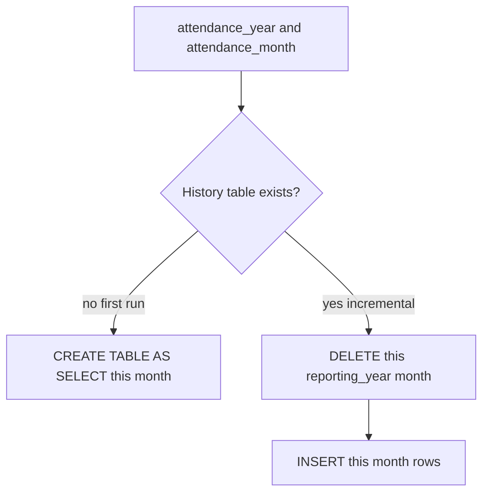
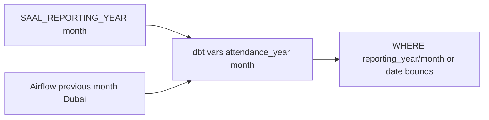

<!-- Generated by SpecStory, Markdown v2.1.0 -->

# 2026-09-09 12:58:46Z

<!-- Cursor IDE Session 2a51e784-3cc4-4e95-a084-192b8ce4b8fd (2026-09-09 12:58:46Z) -->

_**User**_

how are we checking for duplication while appeniding

---

_**Agent (composer-2.5)**_

<think><details><summary>Thought Process</summary>
The user wants to know how duplication is checked during appending.

Examining the attendance status history schema and related tests to understand how duplication is checked during appends.
</details></think>

_**Agent (composer-2.5)**_

I'll look through the attendance append/history models and tests to see how duplicates are detected and blocked.

_**Agent (composer-2.5)**_

<tool-use data-tool-type="unknown" data-tool-name="ripgrep_raw_search"><details>
<summary>Tool use: **ripgrep_raw_search**</summary>

Parameters:

```json
{
  "caseInsensitive": true,
  "glob": "*.{py,sql,yml,yaml,md}",
  "path": "/Users/s.shameem/saal_employee/employee_qa",
  "pattern": "duplicat|append"
}
```
Additional data:

```json
{
  "isPruned": true,
  "outputMode": "content",
  "path": "/Users/s.shameem/saal_employee/employee_qa",
  "pattern": "duplicat|append",
  "topFiles": [
    {
      "matchCount": 2,
      "uri": "./.specstory/history/2026-09-09_11-09-12Z-employee-attendance-status-table.md"
    },
    {
      "matchCount": 2,
      "uri": "./employee_data/tests/test_onsite_employee_columns.py"
    },
    {
      "matchCount": 10,
      "uri": "./saal-data-model/flows/saal_model.py"
    },
    {
      "matchCount": 18,
      "uri": "./employee_data/dependencies/scripts/employee_data.py"
    },
    {
      "matchCount": 15,
      "uri": "./.specstory/history/2026-09-09_06-53-22Z-pipeline-run-month-inquiry.md"
    },
    {
      "matchCount": 10,
      "uri": "./employee_data/dependencies/scripts/onsite_employee.py"
    },
    {
      "matchCount": 10,
      "uri": "./employee_data/dependencies/scripts/leave_data.py"
    },
    {
      "matchCount": 2,
      "uri": "./saal-data-model/python_tests/test_history_period.py"
    },
    {
      "matchCount": 1,
      "uri": "./saal-data-model/models/intermediate/int_attendance_day_history.sql"
    },
    {
      "matchCount": 5,
      "uri": "./saal-data-model/models/semantic/_semantic__models.yml"
    },
    {
      "matchCount": 5,
      "uri": "./saal-data-model/models/intermediate/_intermediate__models.yml"
    }
  ],
  "totalFiles": 11,
  "totalMatches": 408
}
```
Status: **completed**

</details></tool-use>

_**Agent (composer-2.5)**_

<tool-use data-tool-type="read" data-tool-name="read_file_v2"><details>
<summary>Tool use: **read_file_v2** • Read file: /Users/s.shameem/saal_employee/employee_qa/saal-data-model/models/semantic/employee_attendance_status_history.sql</summary>

</details></tool-use>

_**Agent (composer-2.5)**_

<tool-use data-tool-type="read" data-tool-name="read_file_v2"><details>
<summary>Tool use: **read_file_v2** • Read file: /Users/s.shameem/saal_employee/employee_qa/saal-data-model/tests/assert_employee_attendance_status_grain.sql</summary>

</details></tool-use>

_**Agent (composer-2.5)**_

<tool-use data-tool-type="read" data-tool-name="read_file_v2"><details>
<summary>Tool use: **read_file_v2** • Read file: /Users/s.shameem/saal_employee/employee_qa/saal-data-model/python_tests/test_history_period.py</summary>

</details></tool-use>

_**Agent (composer-2.5)**_

<think><details><summary>Thought Process</summary>
The duplication check uses a delete-then-append pattern.

I'll examine the macros and Spark history append logic to explain the full duplication-checking mechanism.

I'll review the history period delete hook, Spark's employee_data.py delete-then-append logic, uniqueness tests for history tables, and unique keys in the dbt YAML. I'm weighing whether to draft an explanatory answer or formalize this into a plan.
</details></think>

_**Agent (composer-2.5)**_

<tool-use data-tool-type="read" data-tool-name="read_file_v2"><details>
<summary>Tool use: **read_file_v2** • Read file: /Users/s.shameem/saal_employee/employee_qa/saal-data-model/macros/history_reporting_period.sql</summary>

</details></tool-use>

_**Agent (composer-2.5)**_

<tool-use data-tool-type="read" data-tool-name="read_file_v2"><details>
<summary>Tool use: **read_file_v2** • Read file: /Users/s.shameem/saal_employee/employee_qa/employee_data/dependencies/scripts/employee_data.py</summary>

</details></tool-use>

_**Agent (composer-2.5)**_

<tool-use data-tool-type="unknown" data-tool-name="ripgrep_raw_search"><details>
<summary>Tool use: **ripgrep_raw_search**</summary>

Parameters:

```json
{
  "caseInsensitive": false,
  "glob": "*.{sql,yml}",
  "path": "/Users/s.shameem/saal_employee/employee_qa/saal-data-model",
  "pattern": "unique|grain|delete from|history_period_delete"
}
```
Additional data:

```json
{
  "isPruned": true,
  "outputMode": "content",
  "path": "/Users/s.shameem/saal_employee/employee_qa/saal-data-model",
  "pattern": "unique|grain|delete from|history_period_delete",
  "topFiles": [
    {
      "matchCount": 1,
      "uri": "saal-data-model/models/intermediate/int_attendance_day_history.sql"
    },
    {
      "matchCount": 2,
      "uri": "saal-data-model/models/semantic/_semantic__models.yml"
    },
    {
      "matchCount": 5,
      "uri": "saal-data-model/models/intermediate/_intermediate__models.yml"
    },
    {
      "matchCount": 1,
      "uri": "saal-data-model/models/semantic/employee_departments_history.sql"
    },
    {
      "matchCount": 1,
      "uri": "saal-data-model/models/semantic/employee_hr_attendance_status_history.sql"
    },
    {
      "matchCount": 1,
      "uri": "saal-data-model/models/semantic/employee_attendance_status_history.sql"
    },
    {
      "matchCount": 1,
      "uri": "saal-data-model/models/semantic/employee_attendance_history.sql"
    },
    {
      "matchCount": 1,
      "uri": "saal-data-model/models/semantic/employee_attendance_report_history.sql"
    },
    {
      "matchCount": 1,
      "uri": "saal-data-model/models/intermediate/int_leave_day_history.sql"
    },
    {
      "matchCount": 1,
      "uri": "saal-data-model/models/intermediate/int_onsite_day_history.sql"
    },
    {
      "matchCount": 1,
      "uri": "saal-data-model/models/intermediate/int_office_day_history.sql"
    },
    {
      "matchCount": 1,
      "uri": "saal-data-model/models/intermediate/int_hr_by_prefix_history.sql"
    },
    {
      "matchCount": 1,
      "uri": "saal-data-model/models/intermediate/int_hr_roster_history.sql"
    },
    {
      "matchCount": 1,
      "uri": "saal-data-model/models/staging/employee/stg_onsite_employee_history.sql"
    },
    {
      "matchCount": 1,
      "uri": "saal-data-model/models/staging/employee/stg_daily_attendance_history.sql"
    },
    {
      "matchCount": 1,
      "uri": "saal-data-model/models/staging/employee/stg_attendance_event_history.sql"
    },
    {
      "matchCount": 1,
      "uri": "saal-data-model/models/staging/employee/stg_leave_data_history.sql"
    },
    {
      "matchCount": 2,
      "uri": "saal-data-model/macros/history_reporting_period.sql"
    },
    {
      "matchCount": 1,
      "uri": "saal-data-model/models/intermediate/int_hr_roster.sql"
    },
    {
      "matchCount": 1,
      "uri": "saal-data-model/macros/employee_identity.sql"
    }
  ],
  "totalFiles": 21,
  "totalMatches": 27
}
```
Status: **completed**

</details></tool-use>

_**Agent (composer-2.5)**_

<tool-use data-tool-type="read" data-tool-name="read_file_v2"><details>
<summary>Tool use: **read_file_v2** • Read file: /Users/s.shameem/saal_employee/employee_qa/saal-data-model/models/semantic/_semantic__models.yml</summary>

</details></tool-use>

_**Agent (composer-2.5)**_

<think><details><summary>Thought Process</summary>
I understand the question about duplication checks during appending.

No row-level uniqueness check occurs at append time. Spark raw history deletes the reporting year and month before appending. dbt history models use incremental_strategy='append' with a pre-hook that deletes the target period first. Post-build grain tests exist only for the current table, not history tables. Iceberg append itself does not enforce uniqueness.

I will call CreatePlan to present the current duplication handling as a concise plan. I also need to check whether Iceberg tables have unique constraints or merge-on-read uniqueness.
</details></think>

_**Agent (composer-2.5)**_

<tool-use data-tool-type="unknown" data-tool-name="ripgrep_raw_search"><details>
<summary>Tool use: **ripgrep_raw_search**</summary>

Parameters:

```json
{
  "caseInsensitive": false,
  "glob": "*.{py,yml,sql}",
  "path": "/Users/s.shameem/saal_employee/employee_qa/employee_data",
  "pattern": "unique|equality.?id|primary.?key"
}
```
Additional data:

```json
{
  "isPruned": true,
  "outputMode": "content",
  "path": "/Users/s.shameem/saal_employee/employee_qa/employee_data",
  "pattern": "unique|equality.?id|primary.?key",
  "topFiles": [
    {
      "matchCount": 2,
      "uri": "employee_data/tests/test_employee_data.py"
    },
    {
      "matchCount": 4,
      "uri": "employee_data/dependencies/scripts/employee_data.py"
    }
  ],
  "totalFiles": 2,
  "totalMatches": 6
}
```
Status: **completed**

</details></tool-use>

_**Agent (composer-2.5)**_

<tool-use data-tool-type="search" data-tool-name="glob_file_search"><details>
<summary>Tool use: **glob_file_search** • Searched codebase "" • **6** results in **1** directory</summary>

Directory: **`/Users/s.shameem/saal_employee/employee_qa/saal-data-model`** (6 files)

| File |
|------|
| `tests/assert_employee_id_is_not_email.sql` |
| `tests/assert_employee_hr_attendance_status_weekdays_only.sql` |
| `tests/assert_employee_hr_attendance_status_grain.sql` |
| `tests/assert_employee_attendance_status_grain.sql` |
| `tests/assert_employee_attendance_report_grain.sql` |
| `tests/assert_stg_daily_attendance_covered_by_int_attendance_day.sql` |
</details></tool-use>

_**Agent (composer-2.5)**_

<tool-use data-tool-type="read" data-tool-name="read_file_v2"><details>
<summary>Tool use: **read_file_v2** • Read file: /Users/s.shameem/saal_employee/employee_qa/saal-data-model/models/intermediate/int_attendance_day_history.sql</summary>

</details></tool-use>

_**Agent (composer-2.5)**_

<think><details><summary>Thought Process</summary>
Ready to explain how duplication is checked during appending.

I'll create a plan to document the current duplication strategy. It will explain the existing check and note any gaps.
</details></think>

_**Agent (composer-2.5)**_

Duplication is prevented by deleting the reporting period before append, not by a uniqueness check at write time. I'll capture that in a short plan.

_**Agent (composer-2.5)**_

<tool-use data-tool-type="unknown" data-tool-name="create_plan"><details>
<summary>Tool use: **create_plan**</summary>

Parameters:

````json
{
  "name": "Append duplication handling",
  "overview": "History tables do not check for duplicate rows at append time. They make re-runs idempotent by deleting the target reporting year-month first, then appending. Grain uniqueness is only asserted later on current (non-history) dbt models.",
  "plan": "# How duplication is handled on append\n\nThere is **no duplicate-row check during Iceberg append**. Append is a blind insert. Re-runs stay idempotent because the **same reporting period is deleted first**.\n\n```mermaid\nflowchart LR\n  period[reporting_year and reporting_month]\n  deleteStep[DELETE that period from target]\n  appendStep[APPEND new rows]\n  period --\u003e deleteStep --\u003e appendStep\n```\n\n## Spark raw history (employee_data)\n\n[`write_iceberg_month_history`](employee_data/dependencies/scripts/employee_data.py) in `employee_data.py` (same pattern in `leave_data.py` and `onsite_employee.py`):\n\n1. Stamp `reporting_year` / `reporting_month` on the dataframe.\n2. Refuse schema drift (extra/missing columns). That is schema safety, not uniqueness.\n3. `DELETE FROM {table} WHERE reporting_year = Y AND reporting_month = M`\n4. `mode(\"append\").insertInto(table)`\n\nIceberg is not given equality IDs or a unique key. If the delete is skipped or targets the wrong month, a second run **duplicates** that period.\n\niClock fetch does dedupe API records in memory (`dedupe_iclock_records`) before write. That is source-record dedupe, not table-grain uniqueness on append.\n\n## dbt history models\n\nHistory models (including [`employee_attendance_status_history.sql`](saal-data-model/models/semantic/employee_attendance_status_history.sql)) use:\n\n- `materialized='incremental'`\n- `incremental_strategy='append'`\n- `pre_hook=\"{{ history_period_delete_hook() }}\"`\n\nThe hook in [`history_reporting_period.sql`](saal-data-model/macros/history_reporting_period.sql):\n\n```sql\ndelete from {{ this }}\nwhere reporting_year = {{ history_reporting_year() }}\n  and reporting_month = {{ history_reporting_month() }}\n```\n\nThe model then only **selects** rows for that period (`history_period_filter()` / `attendance_reporting_bounds()`), so it appends one month, not the full history.\n\nPeriod is `var('attendance_year')` / `var('attendance_month')`, else previous calendar month from `run_started_at`.\n\n`on_table_exists='skip'` and `full_refresh=false` keep other months; they do not unique-check the incoming batch.\n\n## What *is* checked after the fact (not on history append)\n\ndbt singular tests catch **person × date grain** on **current** tables only, for example [`assert_employee_attendance_status_grain.sql`](saal-data-model/tests/assert_employee_attendance_status_grain.sql):\n\n```sql\ngroup by coalesce(\"BusinessEmail\", \"EmployeeID\"), \"Date\"\nhaving count(*) \u003e 1\n```\n\nThere is **no equivalent grain test** on `employee_attendance_status_history` (or other `*_history` models). YAML docs say “incremental delete then append”; they do not declare unique tests on history.\n\n## Practical implication\n\nDuplicates of a month appear if:\n\n- delete did not run (`is_incremental()` false on first create is fine; a failed delete + successful append is not)\n- year/month vars do not match the rows being written\n- two overlapping periods are written under different `reporting_year`/`reporting_month` for the same calendar dates\n\nAppend itself never looks at existing keys.\n"
}
````
Additional data:

```json
{
  "hasOpenedEditor": true,
  "planId": "append_duplication_handling_8f0c1715",
  "planUri": "file:///Users/s.shameem/.cursor/plans/append_duplication_handling_8f0c1715.plan.md",
  "reviewData": {
    "isShowingInput": false,
    "selectedOption": "none",
    "status": "Requested"
  }
}
```
Result:

```json
{
  "rejected": {}
}
```
Status: **completed**

</details></tool-use>

---

_**User**_

what about when for dbt?

---

_**Agent (composer-2.5)**_

<think><details><summary>Thought Process</summary>
The user wants to know how dbt handles duplication compared to Spark.

I'll expand the dbt-specific section of the plan. I need to clarify four points: first-run versus incremental behavior, whether `is_incremental()` skipping deletes causes issues, whether dbt-trino/iceberg uses merge or append, and any unique tests on history models.

First-run materialization creates the table directly without deleting. Incremental runs delete the target period before appending. The SELECT does not deduplicate against existing history rows; uniqueness comes from the upstream model grain. I will now update the plan file with these details.
</details></think>

_**Agent (composer-2.5)**_

I'll expand the dbt-specific path: incremental append, the delete pre-hook, and what is (and isn’t) tested after the run.

_**Agent (composer-2.5)**_

<tool-use data-tool-type="search" data-tool-name="glob_file_search"><details>
<summary>Tool use: **glob_file_search** • Searched codebase "" • **1** result in **1** directory</summary>

Directory: **`/Users/s.shameem/.cursor`** (1 file)

| File |
|------|
| `plans/append_duplication_handling_8f0c1715.plan.md` |
</details></tool-use>

_**Agent (composer-2.5)**_

<tool-use data-tool-type="unknown" data-tool-name="ripgrep_raw_search"><details>
<summary>Tool use: **ripgrep_raw_search**</summary>

Parameters:

```json
{
  "caseInsensitive": false,
  "glob": "*.{sql,yml}",
  "path": "/Users/s.shameem/saal_employee/employee_qa/saal-data-model",
  "pattern": "is_incremental|unique_key|incremental_strategy"
}
```
Additional data:

```json
{
  "isPruned": true,
  "outputMode": "content",
  "path": "/Users/s.shameem/saal_employee/employee_qa/saal-data-model",
  "pattern": "is_incremental|unique_key|incremental_strategy",
  "topFiles": [
    {
      "matchCount": 1,
      "uri": "saal-data-model/models/intermediate/int_attendance_day_history.sql"
    },
    {
      "matchCount": 1,
      "uri": "saal-data-model/models/semantic/employee_departments_history.sql"
    },
    {
      "matchCount": 1,
      "uri": "saal-data-model/models/semantic/employee_hr_attendance_status_history.sql"
    },
    {
      "matchCount": 1,
      "uri": "saal-data-model/models/semantic/employee_attendance_status_history.sql"
    },
    {
      "matchCount": 1,
      "uri": "saal-data-model/models/semantic/employee_attendance_history.sql"
    },
    {
      "matchCount": 1,
      "uri": "saal-data-model/models/semantic/employee_attendance_report_history.sql"
    },
    {
      "matchCount": 1,
      "uri": "saal-data-model/models/intermediate/int_leave_day_history.sql"
    },
    {
      "matchCount": 1,
      "uri": "saal-data-model/models/intermediate/int_onsite_day_history.sql"
    },
    {
      "matchCount": 1,
      "uri": "saal-data-model/models/intermediate/int_office_day_history.sql"
    },
    {
      "matchCount": 1,
      "uri": "saal-data-model/models/intermediate/int_hr_by_prefix_history.sql"
    },
    {
      "matchCount": 1,
      "uri": "saal-data-model/models/intermediate/int_hr_roster_history.sql"
    },
    {
      "matchCount": 1,
      "uri": "saal-data-model/models/staging/employee/stg_onsite_employee_history.sql"
    },
    {
      "matchCount": 1,
      "uri": "saal-data-model/models/staging/employee/stg_daily_attendance_history.sql"
    },
    {
      "matchCount": 1,
      "uri": "saal-data-model/models/staging/employee/stg_attendance_event_history.sql"
    },
    {
      "matchCount": 1,
      "uri": "saal-data-model/models/staging/employee/stg_leave_data_history.sql"
    },
    {
      "matchCount": 1,
      "uri": "saal-data-model/macros/history_reporting_period.sql"
    }
  ],
  "totalFiles": 16,
  "totalMatches": 16
}
```
Status: **completed**

</details></tool-use>

_**Agent (composer-2.5)**_

<tool-use data-tool-type="read" data-tool-name="read_file_v2"><details>
<summary>Tool use: **read_file_v2** • Read file: /Users/s.shameem/saal_employee/employee_qa/saal-data-model/tests/assert_employee_attendance_report_grain.sql</summary>

</details></tool-use>

_**Agent (composer-2.5)**_

<tool-use data-tool-type="read" data-tool-name="read_file_v2"><details>
<summary>Tool use: **read_file_v2** • Read file: /Users/s.shameem/saal_employee/employee_qa/saal-data-model/tests/assert_employee_hr_attendance_status_grain.sql</summary>

</details></tool-use>

_**Agent (composer-2.5)**_

<think><details><summary>Thought Process</summary>
Updating the plan file with a clearer dbt-focused section.

Also checking whether current models use table overwrite or incremental loading.
</details></think>

_**Agent (composer-2.5)**_

<tool-use data-tool-type="read" data-tool-name="read_file_v2"><details>
<summary>Tool use: **read_file_v2** • Read file: /Users/s.shameem/.cursor/plans/append_duplication_handling_8f0c1715.plan.md</summary>

</details></tool-use>

_**Agent (composer-2.5)**_

<tool-use data-tool-type="read" data-tool-name="read_file_v2"><details>
<summary>Tool use: **read_file_v2** • Read file: /Users/s.shameem/saal_employee/employee_qa/saal-data-model/models/semantic/employee_attendance_status.sql</summary>

</details></tool-use>

_**Agent (composer-2.5)**_

<tool-use data-tool-type="unknown" data-tool-name="ripgrep_raw_search"><details>
<summary>Tool use: **ripgrep_raw_search**</summary>

Parameters:

```json
{
  "caseInsensitive": false,
  "glob": "**/employee_attendance*.sql",
  "path": "/Users/s.shameem/saal_employee/employee_qa/saal-data-model/models",
  "pattern": "materialized"
}
```
Additional data:

```json
{
  "isPruned": true,
  "outputMode": "content",
  "path": "/Users/s.shameem/saal_employee/employee_qa/saal-data-model/models",
  "pattern": "materialized",
  "topFiles": [
    {
      "matchCount": 1,
      "uri": "saal-data-model/models/semantic/employee_attendance_status_history.sql"
    },
    {
      "matchCount": 1,
      "uri": "saal-data-model/models/semantic/employee_attendance_history.sql"
    },
    {
      "matchCount": 1,
      "uri": "saal-data-model/models/semantic/employee_attendance_report_history.sql"
    },
    {
      "matchCount": 1,
      "uri": "saal-data-model/models/semantic/employee_attendance_report.sql"
    },
    {
      "matchCount": 1,
      "uri": "saal-data-model/models/semantic/employee_attendance.sql"
    },
    {
      "matchCount": 1,
      "uri": "saal-data-model/models/semantic/employee_attendance_status.sql"
    }
  ],
  "totalFiles": 6,
  "totalMatches": 6
}
```
Status: **completed**

</details></tool-use>

_**Agent (composer-2.5)**_

<think><details><summary>Thought Process</summary>
The dbt section will be expanded to distinguish current models from historical ones.

Current models use full drop-and-replace. This avoids period-level duplicates from re-runs. History models delete then append. They lack a unique key. dbt incremental append does not merge. The is_incremental() flag controls the delete step.
</details></think>

_**Agent (composer-2.5)**_

<tool-use data-tool-type="read" data-tool-name="read_file_v2"><details>
<summary>Tool use: **read_file_v2** • Read file: /Users/s.shameem/.cursor/plans/append_duplication_handling_8f0c1715.plan.md</summary>

</details></tool-use>

_**Agent (composer-2.5)**_

<think><details><summary>Thought Process</summary>
The dbt section will be expanded to clarify differences between current and historical models. It will address absent unique keys, incremental loading, and tests.
</details></think>

_**Agent (composer-2.5)**_

<tool-use data-tool-type="write" data-tool-name="edit_file_v2"><details>
<summary>Tool use: **edit_file_v2** • Edit file: /Users/s.shameem/.cursor/plans/append_duplication_handling_8f0c1715.plan.md</summary>

</details></tool-use>

_**Agent (composer-2.5)**_

<think><details><summary>Thought Process</summary>
The overview should also mention dbt current versus history.
</details></think>

_**Agent (composer-2.5)**_

<tool-use data-tool-type="write" data-tool-name="edit_file_v2"><details>
<summary>Tool use: **edit_file_v2** • Edit file: /Users/s.shameem/.cursor/plans/append_duplication_handling_8f0c1715.plan.md</summary>

</details></tool-use>

_**Agent (composer-2.5)**_

<think><details><summary>Thought Process</summary>
Preparing a clear answer about dbt.
</details></think>

_**Agent (composer-2.5)**_

For **dbt**, duplication is handled in two different ways, depending on the model.

**Current tables** (`employee_attendance_status`, `employee_attendance_report`, and similar) are `materialized='table'` with `on_table_exists='drop'`. Each run rebuilds the whole table, so a re-run cannot stack a second copy of the same month. After the run, grain tests check one row per person and date — for example [`assert_employee_attendance_status_grain.sql`](saal-data-model/tests/assert_employee_attendance_status_grain.sql) groups by `coalesce("BusinessEmail", "EmployeeID")` and `"Date"` and fails if `count(*) > 1`.

**History tables** (`*_history`) do **not** merge or look up existing keys. They use `incremental_strategy='append'` with **no `unique_key`**. Before the insert, [`history_period_delete_hook()`](saal-data-model/macros/history_reporting_period.sql) runs only when the table already exists (`is_incremental()`):

```sql
delete from {{ this }}
where reporting_year = ...
  and reporting_month = ...
```

Then dbt inserts the model SQL, which is already filtered to that same year-month. Idempotency is “delete this period, then append,” not a uniqueness check. There is no grain test on the history models.

So in dbt, append never de-duplicates against Iceberg. Current tables avoid duplicates by replacing the table and testing grain; history tables avoid month-level duplicates by deleting that `reporting_year` / `reporting_month` first.

---

_**User**_

instead of rebuilding the whole table is it posible to keep any unique key for the dbt layer?

---

_**Agent (composer-2.5)**_

<think><details><summary>Thought Process</summary>
The user wants to know if a unique key at the dbt layer can avoid rebuilding the entire table.

Checking the dbt adapter and whether incremental merge with unique_key is supported. Reviewing current table grain and existing monthly partitioning. Will inspect the dbt project configuration and how models apply their period filters.
</details></think>

_**Agent (composer-2.5)**_

I'll check the dbt adapter and current-table grain so we can say whether a unique-key incremental merge is viable instead of full rebuilds.

_**Agent (composer-2.5)**_

<tool-use data-tool-type="search" data-tool-name="glob_file_search"><details>
<summary>Tool use: **glob_file_search** • Searched codebase "" • **2** results in **1** directory</summary>

Directory: **`/Users/s.shameem/saal_employee/employee_qa/saal-data-model`** (2 files)

| File |
|------|
| `dbt_project.yml` |
| `profiles.yml` |
</details></tool-use>

_**Agent (composer-2.5)**_

<tool-use data-tool-type="unknown" data-tool-name="ripgrep_raw_search"><details>
<summary>Tool use: **ripgrep_raw_search**</summary>

Parameters:

```json
{
  "caseInsensitive": false,
  "glob": "*.{yml,yaml,cfg,toml,md,txt}",
  "path": "/Users/s.shameem/saal_employee/employee_qa/saal-data-model",
  "pattern": "trino|iceberg|unique_key|incremental"
}
```
Additional data:

```json
{
  "isPruned": true,
  "outputMode": "content",
  "path": "/Users/s.shameem/saal_employee/employee_qa/saal-data-model",
  "pattern": "trino|iceberg|unique_key|incremental",
  "topFiles": [
    {
      "matchCount": 3,
      "uri": "saal-data-model/models/staging/sources.yml"
    },
    {
      "matchCount": 3,
      "uri": "saal-data-model/dbt_project.yml"
    },
    {
      "matchCount": 8,
      "uri": "saal-data-model/profiles.yml"
    },
    {
      "matchCount": 2,
      "uri": "saal-data-model/requirements.txt"
    }
  ],
  "totalFiles": 4,
  "totalMatches": 16
}
```
Status: **completed**

</details></tool-use>

_**Agent (composer-2.5)**_

<tool-use data-tool-type="unknown" data-tool-name="ask_question"><details>
<summary>Tool use: **ask_question**</summary>

Parameters:

```json
{
  "questions": [
    {
      "id": "which_models",
      "options": [
        {
          "id": "current_only",
          "label": "Current month tables only (employee_attendance_status, report, etc.) — incremental merge on person+date"
        },
        {
          "id": "history_only",
          "label": "History tables only — merge on unique key instead of delete+append"
        },
        {
          "id": "both",
          "label": "Both current and history tables"
        },
        {
          "id": "unsure",
          "label": "Not sure yet — recommend the safest option"
        }
      ],
      "prompt": "Which dbt tables should keep a unique key and stop full rebuilds? History already delete-then-appends by month; current tables currently drop and recreate."
    }
  ],
  "title": "Scope of unique-key incremental dbt"
}
```
Additional data:

```json
{
  "currentSelections": {
    "which_models": [
      "history_only"
    ]
  },
  "freeformTexts": {
    "which_models": ""
  },
  "status": "submitted"
}
```
Result:

```json
{
  "answers": [
    {
      "freeformText": "",
      "questionId": "which_models",
      "selectedOptionIds": [
        "history_only"
      ]
    }
  ]
}
```
User decision: **accepted**

Status: **completed**

</details></tool-use>

_**Agent (composer-2.5)**_

<think><details><summary>Thought Process</summary>
The user selected history_only. They want to keep a unique key in the dbt layer by merging history tables rather than deleting and appending.

Checking which columns form the unique key for each history table. Employee and date may not be unique across all history models. Need to verify whether dbt-trino merge works with Iceberg and Trino.

Merging on person_key and Date would update existing rows rather than rebuild the entire table. Event-level staging tables may lack a natural unique key. MERGE requires the unique key to identify rows in both source and destination.

Source duplicates on the unique key could cause merge failures or duplicate rows. Need to check the dbt-trino merge implementation and whether the catalog is Iceberg. The user may be confused because history tables currently delete and append monthly rather than rebuilding entirely. Need to compare MERGE performance against delete and append for a full month.
</details></think>

_**Agent (composer-2.5)**_

<tool-use data-tool-type="read" data-tool-name="read_file_v2"><details>
<summary>Tool use: **read_file_v2** • Read file: /Users/s.shameem/saal_employee/employee_qa/saal-data-model/dbt_project.yml</summary>

</details></tool-use>

_**Agent (composer-2.5)**_

<tool-use data-tool-type="read" data-tool-name="read_file_v2"><details>
<summary>Tool use: **read_file_v2** • Read file: /Users/s.shameem/saal_employee/employee_qa/saal-data-model/models/staging/employee/stg_attendance_event_history.sql</summary>

</details></tool-use>

_**Agent (composer-2.5)**_

<tool-use data-tool-type="read" data-tool-name="read_file_v2"><details>
<summary>Tool use: **read_file_v2** • Read file: /Users/s.shameem/saal_employee/employee_qa/saal-data-model/models/intermediate/int_attendance_day_history.sql</summary>

</details></tool-use>

_**Agent (composer-2.5)**_

<tool-use data-tool-type="unknown" data-tool-name="ripgrep_raw_search"><details>
<summary>Tool use: **ripgrep_raw_search**</summary>

Parameters:

```json
{
  "caseInsensitive": false,
  "glob": "**/*.{md,yml,py,sql}",
  "path": "/Users/s.shameem/saal_employee/employee_qa",
  "pattern": "incremental_strategy|merge"
}
```
Additional data:

```json
{
  "isPruned": true,
  "outputMode": "content",
  "path": "/Users/s.shameem/saal_employee/employee_qa",
  "pattern": "incremental_strategy|merge",
  "topFiles": [
    {
      "matchCount": 8,
      "uri": "./.specstory/history/2026-09-09_12-58-46Z-duplication-check-during-append.md"
    },
    {
      "matchCount": 1,
      "uri": "./.specstory/history/2026-09-09_11-09-12Z-employee-attendance-status-table.md"
    },
    {
      "matchCount": 7,
      "uri": "./saal-data-model/flows/saal_model.py"
    },
    {
      "matchCount": 9,
      "uri": "./.specstory/history/2026-09-09_06-53-22Z-pipeline-run-month-inquiry.md"
    },
    {
      "matchCount": 6,
      "uri": "./saal-data-model/python_tests/test_history_period.py"
    },
    {
      "matchCount": 3,
      "uri": "./saal-data-model/models/intermediate/int_attendance_day_history.sql"
    },
    {
      "matchCount": 1,
      "uri": "./saal-data-model/models/semantic/_semantic__models.yml"
    },
    {
      "matchCount": 1,
      "uri": "./saal-data-model/models/intermediate/_intermediate__models.yml"
    },
    {
      "matchCount": 1,
      "uri": "./saal-data-model/models/semantic/employee_departments_history.sql"
    },
    {
      "matchCount": 1,
      "uri": "./saal-data-model/models/semantic/employee_hr_attendance_status_history.sql"
    },
    {
      "matchCount": 1,
      "uri": "./saal-data-model/models/semantic/employee_attendance_status_history.sql"
    },
    {
      "matchCount": 1,
      "uri": "./saal-data-model/models/semantic/employee_attendance_history.sql"
    }
  ],
  "totalFiles": 12,
  "totalMatches": 192
}
```
Status: **completed**

</details></tool-use>

_**Agent (composer-2.5)**_

<tool-use data-tool-type="read" data-tool-name="read_file_v2"><details>
<summary>Tool use: **read_file_v2** • Read file: /Users/s.shameem/saal_employee/employee_qa/saal-data-model/models/staging/employee/stg_leave_data_history.sql</summary>

</details></tool-use>

_**Agent (composer-2.5)**_

<think><details><summary>Thought Process</summary>
Checking dbt-trino merge support to see if incremental updates are possible without rebuilding the entire table.

dbt-trino supports `incremental_strategy='merge'` with a `unique_key`. The history model already avoids full rebuilds. Unique keys work well for day-grain semantic models. Event-level staging may need `event_id` plus reporting period, or continue with delete-and-append. MERGE on Iceberg requires unique keys in the incoming batch; Iceberg does not enforce unique constraints physically, so dbt merge is application-level.

A critical issue emerged for `employee_attendance_status_history`: `BusinessEmail` can be null, which breaks MERGE logic because `NULL != NULL`. Using `EmployeeID` as part of the unique key is also risky, since it may not be unique across different employees. The current grain already coalesces email with ID, so a stable unique key for incremental merge is still unresolved.

A computed `person_key` combined with `Date` looks like the most reliable unique key for the attendance history model. I am checking whether dbt-trino supports expression-based `unique_key` values. The departments history grain uses department plus reporting year and month. For the attendance event history, `event_id` should be sufficient as the unique key.

Leave history spans multiple days per request, so its grain likely includes employee and leave date range. I will review the leave history select list and daily attendance next.

The implementation plan now covers history-only layers, recommended unique keys per layer, a null-safe person_key, and the requirement that incoming batches must be unique. If switching to merge, the delete hook should be removed rather than kept, since delete-then-merge is redundant.

I will add tests to verify unique key combinations on history models. A phased rollout is best: apply merge to semantic day-grain models first, and keep delete-and-append on event-level staging unless event_id is guaranteed unique. I also need to update `test_history_period.py`, which currently asserts append strategy. Next I will review the leave, daily attendance, and employee departments history outputs.
</details></think>

_**Agent (composer-2.5)**_

<tool-use data-tool-type="read" data-tool-name="read_file_v2"><details>
<summary>Tool use: **read_file_v2** • Read file: /Users/s.shameem/saal_employee/employee_qa/saal-data-model/models/staging/employee/stg_leave_data_history.sql</summary>

</details></tool-use>

_**Agent (composer-2.5)**_

<tool-use data-tool-type="read" data-tool-name="read_file_v2"><details>
<summary>Tool use: **read_file_v2** • Read file: /Users/s.shameem/saal_employee/employee_qa/saal-data-model/models/semantic/employee_departments_history.sql</summary>

</details></tool-use>

_**Agent (composer-2.5)**_

<tool-use data-tool-type="read" data-tool-name="read_file_v2"><details>
<summary>Tool use: **read_file_v2** • Read file: /Users/s.shameem/saal_employee/employee_qa/saal-data-model/models/staging/employee/stg_daily_attendance_history.sql</summary>

</details></tool-use>

_**Agent (composer-2.5)**_

<tool-use data-tool-type="unknown" data-tool-name="web_search"><details>
<summary>Tool use: **web_search**</summary>

Parameters:

```json
{
  "searchTerm": "dbt-trino incremental_strategy merge unique_key Iceberg"
}
```
Result:

```json
{
  "isFinal": true,
  "references": [
    {
      "chunk": "Links:\n1. [About incremental strategy | dbt Developer Hub](https://docs.getdbt.com/docs/build/incremental-strategy)\n2. [Refresh your data faster using incremental models | Starburst](https://www.starburst.io/blog/lakehouse-data-pipeline-dbt-trino/incremental-models/)\n3. [dbt-trino v1.3.2](https://pypi.org/project/dbt-trino/1.3.2/)\n4. [Apache Iceberg with dbt: Optimization Guide - LakeOps Blog](https://lakeops.dev/blog/dbt-iceberg-optimization)\n5. [Apache Iceberg Delete Files: Reducing Merge-on-Read Overhead - LakeOps Blog](https://lakeops.dev/blog/iceberg-delete-files-merge-on-read)\n\nSynthesis:\nTo use the merge strategy with dbt-trino and Iceberg, set the incremental_strategy to merge in your model config and provide a unique_key to enable row-level upserts [1][2][3]. On Iceberg v2 tables, this produces merge-on-read position delete files that reconcile at query time [4][5]. Because Trino can create excessive delete files on tables partitioned only by identity transforms, avoid these partitions or add a transformation like bucket to improve performance [6]. You must periodically run Iceberg's rewrite_data_files procedure to compact data and resolve delete files to prevent query degradation and out-of-memory errors [5][7].\n\nHighlights:\n\u003cresult id=\"1\"\u003e\n\u003ctitle\u003eAbout incremental strategy | dbt Developer Hub\u003c/title\u003e\n\u003curl\u003ehttps://docs.getdbt.com/docs/build/incremental-strategy\u003c/url\u003e\n\u003ccontent\u003e| Data platform adapter | `append` | `merge` | `delete+insert` | `insert_overwrite` | `microbatch` |\n| --- | --- | --- | --- | --- | --- |\n| dbt-postgres | ✅ | ✅ | ✅ | | ✅ |\n| dbt-redshift | ✅ | ✅ | ✅ | | ✅ |\n| dbt-bigquery | | ✅ | | ✅ | ✅ |\n| dbt-spark | ✅ | ✅ | | ✅ | ✅ |\n| dbt-databricks | ✅ | ✅ | ✅ | ✅ | ✅ |\n| dbt-snowflake | ✅ | ✅ | ✅ | ✅ | ✅ |\n| dbt-trino | ✅ | ✅ | ✅ | | ✅ |\n| dbt-fabric | ✅ | ✅ | ✅ | | ✅ |\n| dbt-athena | ✅ | ✅ | | ✅ |
… (output truncated)
```
User decision: **accepted**

Status: **completed**

</details></tool-use>

_**Agent (composer-2.5)**_

<think><details><summary>Thought Process</summary>
dbt-trino allows using a delete+insert strategy when the unique key is not unique.

Delete+insert with unique_key does not remove rows that exist in destination but not in the current source. A full monthly rewrite would therefore retain employees who disappeared from that month's source. Deleting the entire period first and then appending would correctly remove those rows.

A merge-only strategy would leave orphaned rows for employees who disappeared from the source. Keeping the period delete hook is still required to properly replace the month. Even with a composite unique key, deleting the entire period first is necessary to remove vanished keys.

Merging after a period delete is redundant. The period delete hook is still required for correct month replacement.

unique_key cannot replace the period delete for monthly snapshots. It only prevents duplicate inserts and enables merge for point updates. Using a composite unique key with merge alongside the period delete is a safer fallback. Iceberg cannot enforce unique constraints natively; unique_key is only used in the MERGE SQL. The plan will be updated accordingly.

History already avoids rebuilding the entire table. A unique key is possible, but it should not replace the period delete. Event-level tables can use event_id as the key. Leave records lack a unique employee-month key because their date ranges overlap. Tests should be added for these changes.

I will edit the existing plan file directly instead of calling CreatePlan again.
</details></think>

_**Agent (composer-2.5)**_

<tool-use data-tool-type="read" data-tool-name="read_file_v2"><details>
<summary>Tool use: **read_file_v2** • Read file: /Users/s.shameem/.cursor/plans/append_duplication_handling_8f0c1715.plan.md</summary>

</details></tool-use>

_**Agent (composer-2.5)**_

<think><details><summary>Thought Process</summary>
A new section on unique_key for history will be added to the plan. It will cover the recommended approach, caveats, and implementation todos.

The recommended approach uses a unique_key with merge or delete+insert on semantic day-grain history. The period delete hook should remain. This preserves month-replace semantics without rebuilding the entire table.

Option A is weak because the unique_key only helps if the period delete hook is skipped. Option B would require custom deletion logic outside dbt. Option C uses delete+insert with a unique_key on person+date, letting dbt handle the month replacement natively.

Period delete is still required for vanished employees. Unique_key cannot replace it for monthly snapshots.

It is useful for incremental upserts, dbt tests, documenting grain, and ensuring batch uniqueness.

The first concrete step is to persist a `person_key` column and add unique tests on the history semantic models. Optionally, the semantic history could switch to merge with a unique_key on `person_key` and `Date`, while keeping the period delete hook as a safety net. Event and leave staging tables lack a single person-plus-date key. Quoted Iceberg columns such as "EmployeeID" and "Date" may need exact naming in the dbt-trino unique_key configuration. Implementation todos will be added to the plan.

Staging tables should not switch to merge. The response will confirm that unique_key is possible but constrained, and the plan will remain actionable for approval.
</details></think>

_**Agent (composer-2.5)**_

<tool-use data-tool-type="write" data-tool-name="edit_file_v2"><details>
<summary>Tool use: **edit_file_v2** • Edit file: /Users/s.shameem/.cursor/plans/append_duplication_handling_8f0c1715.plan.md</summary>

</details></tool-use>

_**Agent (composer-2.5)**_

<tool-use data-tool-type="write" data-tool-name="edit_file_v2"><details>
<summary>Tool use: **edit_file_v2** • Edit file: /Users/s.shameem/.cursor/plans/append_duplication_handling_8f0c1715.plan.md</summary>

</details></tool-use>

_**Agent (composer-2.5)**_

<think><details><summary>Thought Process</summary>
Preparing a clear user-facing answer.

Focusing on constraints and recommendations rather than plan file internals.
</details></think>

_**Agent (composer-2.5)**_

Yes. On the **history** dbt models you already keep prior months; they are not full-table rebuilds. dbt-trino can take a `unique_key` with `incremental_strategy='merge'` (or `delete+insert`). Iceberg still will not enforce uniqueness as a table constraint; the key is only used in that SQL.

A unique key **does not replace** the month `DELETE`. Merge only updates or inserts keys that are **in this run**. If someone drops out of the month, that old history row stays unless you still delete `reporting_year` / `reporting_month` first. Keep [`history_period_delete_hook()`](saal-data-model/macros/history_reporting_period.sql).

**Where a unique key works**

- Day-grain semantic history (`employee_attendance_status_history`, report, attendance): `coalesce(BusinessEmail, EmployeeID)` + `Date`. Persist that as `person_key` so merge does not break on null emails.
- HR status history: `EmployeeID` + `Date`.
- Departments history: `department` + reporting year/month.

**Where it does not**

- Punch events: many rows per person-day (`event_id` at most).
- Leave requests: one row per leave range, not per day.

**Practical recommendation:** keep delete-then-append for the month, add `unique_key` plus grain tests on the day-grain history models (and optionally `merge` as a second line of defense). Do not switch leave/event staging to person+date merge.

Current month tables can stay as full rebuilds unless you want that pattern there later.

---

_**User**_

like now how the history tables are appending in dbt layer?

---

_**Agent (composer-2.5)**_

<think><details><summary>Thought Process</summary>
The user wants a clearer explanation of how history tables currently append in the dbt layer.

I will walk through the current dbt incremental append flow. I may also update the plan to clarify this behavior.

I will verify the exact history model configuration and macro. I will also check how saal_model.py passes the attendance year and month variables. This ensures the explanation is fully accurate.
</details></think>

_**Agent (composer-2.5)**_

I'll walk through the current dbt history append path as it actually runs today, including period vars and the delete-then-insert sequence.

_**Agent (composer-2.5)**_

<tool-use data-tool-type="unknown" data-tool-name="ripgrep_raw_search"><details>
<summary>Tool use: **ripgrep_raw_search**</summary>

Parameters:

```json
{
  "caseInsensitive": false,
  "path": "/Users/s.shameem/saal_employee/employee_qa/saal-data-model/flows/saal_model.py",
  "pattern": "attendance_year|dbt run|history"
}
```
Additional data:

```json
{
  "isPruned": true,
  "outputMode": "content",
  "path": "/Users/s.shameem/saal_employee/employee_qa/saal-data-model/flows/saal_model.py",
  "pattern": "attendance_year|dbt run|history",
  "topFiles": [
    {
      "matchCount": 7,
      "uri": "saal-data-model/flows/saal_model.py"
    }
  ],
  "totalFiles": 1,
  "totalMatches": 7
}
```
Status: **completed**

</details></tool-use>

_**Agent (composer-2.5)**_

<tool-use data-tool-type="read" data-tool-name="read_file_v2"><details>
<summary>Tool use: **read_file_v2** • Read file: /Users/s.shameem/saal_employee/employee_qa/saal-data-model/models/semantic/employee_attendance_status_history.sql</summary>

</details></tool-use>

_**Agent (composer-2.5)**_

<tool-use data-tool-type="read" data-tool-name="read_file_v2"><details>
<summary>Tool use: **read_file_v2** • Read file: /Users/s.shameem/saal_employee/employee_qa/saal-data-model/macros/history_reporting_period.sql</summary>

</details></tool-use>

_**Agent (composer-2.5)**_

<think><details><summary>Thought Process</summary>
Checking how variables are passed in saal_model.py around line 511.
</details></think>

_**Agent (composer-2.5)**_

<tool-use data-tool-type="read" data-tool-name="read_file_v2"><details>
<summary>Tool use: **read_file_v2** • Read file: /Users/s.shameem/saal_employee/employee_qa/saal-data-model/flows/saal_model.py</summary>

</details></tool-use>

_**Agent (composer-2.5)**_

<tool-use data-tool-type="read" data-tool-name="read_file_v2"><details>
<summary>Tool use: **read_file_v2** • Read file: /Users/s.shameem/saal_employee/employee_qa/saal-data-model/models/semantic/employee_attendance_status_history.sql</summary>

</details></tool-use>

_**Agent (composer-2.5)**_

<think><details><summary>Thought Process</summary>
I will explain how history tables currently append data in the dbt layer.

I'll use plain language and a mermaid diagram to show the current append logic. I won't mention the unique_key proposal.
</details></think>

_**Agent (composer-2.5)**_

Today, dbt history tables **do not upsert**. They **delete one reporting month, then insert that month again**. Other months are left alone.

**What “append” means here**

Each `*_history` model is `materialized='incremental'` with `incremental_strategy='append'`. There is no `unique_key`. dbt-trino therefore runs an `INSERT INTO` of whatever the model SQL returns. It does not match existing rows.

`on_table_exists='skip'` and `full_refresh=false` stop dbt from dropping the Iceberg table, so July stays when you load August.

**Which month**

Airflow/`saal_model.py` passes `--vars` like `attendance_year` / `attendance_month`. If those vars are missing, the macros use the previous calendar month from `run_started_at`.

**One run, after the table already exists** (`is_incremental()` is true)

1. **Pre-hook** [`history_period_delete_hook()`](saal-data-model/macros/history_reporting_period.sql):

```sql
delete from <this_history_table>
where reporting_year = 2026
  and reporting_month = 8
```

2. **Select** only that period from upstream history (`history_period_filter()` and/or date bounds), and stamp the same year/month with `history_period_columns()`.

3. **Append** those rows with `INSERT`.

**First run** (table does not exist yet): the delete hook is skipped. dbt creates the table from that same select (one month). Later runs use delete + insert.



**Example:** [`employee_attendance_status_history`](saal-data-model/models/semantic/employee_attendance_status_history.sql) reads `int_attendance_day_history` for that month, builds status rows, adds `reporting_year` / `reporting_month`, and inserts. It never looks at `EmployeeID` + `Date` against rows already in the table. Deduping a re-run of August is only “wipe August, write August again.”

The same pattern is on staging, intermediate, and semantic history models (leave, punches, office/onsite/leave days, status, report, departments).

---

_**User**_

how do the dbt layer knows which month data are we loading 

---

_**Agent (composer-2.5)**_

<think><details><summary>Thought Process</summary>
The user wants to know how the dbt layer identifies which month's data is being loaded.

Checking saal_model.py and the history_reporting_period macros. Also reviewing attendance_reporting_bounds and spark_period_env to map out the full period resolution chain.
</details></think>

_**Agent (composer-2.5)**_

I'll trace how the reporting year and month are chosen and passed into dbt, from Airflow/env down to the SQL filters.

_**Agent (composer-2.5)**_

<tool-use data-tool-type="unknown" data-tool-name="ripgrep_raw_search"><details>
<summary>Tool use: **ripgrep_raw_search**</summary>

Parameters:

```json
{
  "caseInsensitive": false,
  "glob": "*.{py,sql,yml}",
  "path": "/Users/s.shameem/saal_employee/employee_qa/saal-data-model",
  "pattern": "attendance_year|attendance_month|SAAL_REPORTING|attendance_reporting_bounds"
}
```
Additional data:

```json
{
  "isPruned": true,
  "outputMode": "content",
  "path": "/Users/s.shameem/saal_employee/employee_qa/saal-data-model",
  "pattern": "attendance_year|attendance_month|SAAL_REPORTING|attendance_reporting_bounds",
  "topFiles": [
    {
      "matchCount": 3,
      "uri": "saal-data-model/python_tests/test_dbt_runner.py"
    },
    {
      "matchCount": 5,
      "uri": "saal-data-model/flows/saal_model.py"
    },
    {
      "matchCount": 2,
      "uri": "saal-data-model/python_tests/test_history_period.py"
    },
    {
      "matchCount": 1,
      "uri": "saal-data-model/models/semantic/employee_hr_attendance_status_history.sql"
    },
    {
      "matchCount": 1,
      "uri": "saal-data-model/models/semantic/employee_attendance_status_history.sql"
    },
    {
      "matchCount": 1,
      "uri": "saal-data-model/models/semantic/employee_attendance_report_history.sql"
    },
    {
      "matchCount": 6,
      "uri": "saal-data-model/macros/history_reporting_period.sql"
    },
    {
      "matchCount": 1,
      "uri": "saal-data-model/models/semantic/employee_hr_attendance_status.sql"
    },
    {
      "matchCount": 2,
      "uri": "saal-data-model/models/semantic/employee_attendance_report.sql"
    },
    {
      "matchCount": 3,
      "uri": "saal-data-model/models/semantic/employee_attendance_status.sql"
    },
    {
      "matchCount": 5,
      "uri": "saal-data-model/macros/attendance_reporting_bounds.sql"
    }
  ],
  "totalFiles": 11,
  "totalMatches": 30
}
```
Status: **completed**

</details></tool-use>

_**Agent (composer-2.5)**_

<tool-use data-tool-type="search" data-tool-name="glob_file_search"><details>
<summary>Tool use: **glob_file_search** • Searched codebase "" • **2** results in **1** directory</summary>

Directory: **`/Users/s.shameem/saal_employee/employee_qa/saal-data-model`** (2 files)

| File |
|------|
| `macros/history_reporting_period.sql` |
| `macros/attendance_reporting_bounds.sql` |
</details></tool-use>

_**Agent (composer-2.5)**_

<think><details><summary>Thought Process</summary>
Checking how dbt variables are passed in saal_model.py and how attendance_reporting_bounds.sql determines the month.

Also checking spark_period_env for Spark-side month determination.
</details></think>

_**Agent (composer-2.5)**_

<tool-use data-tool-type="read" data-tool-name="read_file_v2"><details>
<summary>Tool use: **read_file_v2** • Read file: /Users/s.shameem/saal_employee/employee_qa/saal-data-model/macros/attendance_reporting_bounds.sql</summary>

</details></tool-use>

_**Agent (composer-2.5)**_

<tool-use data-tool-type="unknown" data-tool-name="ripgrep_raw_search"><details>
<summary>Tool use: **ripgrep_raw_search**</summary>

Parameters:

```json
{
  "caseInsensitive": false,
  "path": "/Users/s.shameem/saal_employee/employee_qa/saal-data-model/flows/saal_model.py",
  "pattern": "--vars|dbt_vars|_dbt_vars"
}
```
Additional data:

```json
{
  "isPruned": true,
  "outputMode": "content",
  "path": "/Users/s.shameem/saal_employee/employee_qa/saal-data-model/flows/saal_model.py",
  "pattern": "--vars|dbt_vars|_dbt_vars",
  "topFiles": [
    {
      "matchCount": 7,
      "uri": "saal-data-model/flows/saal_model.py"
    }
  ],
  "totalFiles": 1,
  "totalMatches": 7
}
```
Status: **completed**

</details></tool-use>

_**Agent (composer-2.5)**_

<tool-use data-tool-type="read" data-tool-name="read_file_v2"><details>
<summary>Tool use: **read_file_v2** • Read file: /Users/s.shameem/saal_employee/employee_qa/employee_data/flows/spark_period_env.py</summary>

</details></tool-use>

_**Agent (composer-2.5)**_

<tool-use data-tool-type="read" data-tool-name="read_file_v2"><details>
<summary>Tool use: **read_file_v2** • Read file: /Users/s.shameem/saal_employee/employee_qa/saal-data-model/flows/saal_model.py</summary>

</details></tool-use>

_**Agent (composer-2.5)**_

<think><details><summary>Thought Process</summary>
Checking `_attendance_period_from_airflow_context` and `_current_attendance_period` to understand how the dbt layer determines the current month.
</details></think>

_**Agent (composer-2.5)**_

<tool-use data-tool-type="read" data-tool-name="read_file_v2"><details>
<summary>Tool use: **read_file_v2** • Read file: /Users/s.shameem/saal_employee/employee_qa/saal-data-model/flows/saal_model.py</summary>

</details></tool-use>

_**Agent (composer-2.5)**_

<think><details><summary>Thought Process</summary>
I now have a complete picture. I need to search for `_attendance_period_from_airflow_context` to find how the month is determined.
</details></think>

_**Agent (composer-2.5)**_

<tool-use data-tool-type="unknown" data-tool-name="ripgrep_raw_search"><details>
<summary>Tool use: **ripgrep_raw_search**</summary>

Parameters:

```json
{
  "caseInsensitive": false,
  "contextAfter": 40,
  "path": "/Users/s.shameem/saal_employee/employee_qa/saal-data-model/flows/saal_model.py",
  "pattern": "def _attendance_period_from_airflow"
}
```
Additional data:

```json
{
  "isPruned": true,
  "outputMode": "content",
  "path": "/Users/s.shameem/saal_employee/employee_qa/saal-data-model/flows/saal_model.py",
  "pattern": "def _attendance_period_from_airflow",
  "topFiles": [
    {
      "matchCount": 41,
      "uri": "saal-data-model/flows/saal_model.py"
    }
  ],
  "totalFiles": 1,
  "totalMatches": 1
}
```
Status: **completed**

</details></tool-use>

_**Agent (composer-2.5)**_

<think><details><summary>Thought Process</summary>
Checking `_pendulum_or_datetime_to_period` to confirm the previous month in Dubai.
</details></think>

_**Agent (composer-2.5)**_

<tool-use data-tool-type="read" data-tool-name="read_file_v2"><details>
<summary>Tool use: **read_file_v2** • Read file: /Users/s.shameem/saal_employee/employee_qa/saal-data-model/flows/saal_model.py</summary>

</details></tool-use>

_**Agent (composer-2.5)**_

<think><details><summary>Thought Process</summary>
dbt does not inspect data files to determine the month. It receives the month through variables.

Models filter upstream data by reporting year and month. Spark already stamped those fields. Date bounds may also apply.
</details></think>

_**Agent (composer-2.5)**_

dbt does not infer the month from the data. The **run is told** the year and month, then SQL **filters** to that period.

**1. Period is chosen before dbt**

[`saal_model.py`](saal-data-model/flows/saal_model.py) builds `--vars` as `attendance_year` and `attendance_month`, in this order:

1. Env `SAAL_REPORTING_YEAR` / `SAAL_REPORTING_MONTH` (same names Spark uses).
2. Else Airflow context: **previous calendar month in Asia/Dubai** — manual runs from `logical_date`, scheduled/backfill from `data_interval_end`.
3. Else “now” in Dubai, minus one month.

That becomes something like:

`dbt run ... --vars '{"attendance_year": 2026, "attendance_month": 8}'`

**2. Models read those vars**

[`history_reporting_year()` / `history_reporting_month()`](saal-data-model/macros/history_reporting_period.sql) and [`attendance_reporting_bounds()`](saal-data-model/macros/attendance_reporting_bounds.sql) use `var('attendance_year')` and `var('attendance_month')`. If you run dbt locally **without** `--vars`, they fall back to the previous calendar month from `run_started_at`.

**3. That month is applied in SQL in two ways**

- **History chain:** Spark already stored `reporting_year` / `reporting_month` on raw history. Staging/intermediate history keep only matching rows (`history_period_filter()`), delete that same pair on the target, then insert, and stamp the columns again with `history_period_columns()`.
- **Date window:** Semantic status/report models also restrict `attendance_date` to `[period_start, period_end)` — first of that month through first of the next.



So for August 2026, dbt loads whatever is in upstream history **for `reporting_year = 2026` and `reporting_month = 8`**, not “whatever is newest in the lake.” If Spark wrote a different month than the vars, dbt will filter to an empty (or wrong) set.
